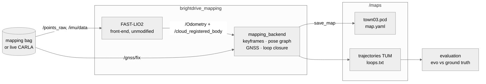

# BrightDrive — Localization & Mapping

CARLA 0.9.15 · Town03 · ROS 2 Humble · C++

| Component | Status | Folder |
|---|---|---|
| Error-state Kalman filter (IMU + GNSS), pure C++ | in progress | [`eskf/`](eskf/README.md) |
| Mapping: FAST-LIO (upstream) → pose graph, loop closure, GNSS factors (mine) → `map.pcd` | skeleton | [`mapping/brightdrive_mapping/`](mapping/brightdrive_mapping/README.md) |

## Data

Maps and bags are not in git. Download them from
[Google Drive](https://drive.google.com/drive/folders/1Glp70xwr7zoCV1obQUhzevf8z3eG_zW0?usp=sharing)
(`UPLOAD_LIST.md` there lists every file with its checksum). Put the maps in `MAPS_DIR` (`/var/tmp/brightdrive_maps`
on the host, `/maps` in the containers) and the bags in `BAGS_DIR` (`/var/tmp/brightdrive_bags`, `/bags` in the
containers); the commands in the READMEs then work as written.

## Simulation

CARLA 0.9.15 server and a ROS 2 Humble client, both in Docker: `compose.yaml` (all services), `compose.viz.yaml`
(optional window), `.env` (`UID`/`GID`, `BD_ROS_DOMAIN_ID`, `BAGS_DIR`, `MAPS_DIR`), `docker/`. ROS containers share `x-ros-env` in
`compose.yaml`: domain 42, localhost only, Fast DDS with the profile in `docker/fastdds_shm.xml`. Needs Docker Compose v2,
the NVIDIA container runtime (`docker info | grep -i runtimes` lists `nvidia`), an NVIDIA driver (580.x here) and
the server image (`docker pull carlasim/carla:0.9.15`, 21 GB).

.env holds local defaults (UID/GID, ROS domain, bag and map folders); adjust them for your machine.

| Service | What |
|---|---|
| `carla-server` | `carlasim/carla:0.9.15` pinned by digest, GPU through the `nvidia` runtime, host network, `-RenderOffScreen -quality-level=Epic`, starts in Town03 (`docker/UserEngine.ini`), healthcheck on the RPC port 2000 |
| `sim` | `docker/Dockerfile` stage `sim`: Humble + numpy from apt + the `carla==0.9.15` wheel. Host network + IPC, runs as your uid/gid, repo at `/ws/src/brightdrive_localization`, bags at `/bags`, idle (`sleep infinity`) until you exec into it |
| `mapping` | `docker/Dockerfile` stage `mapping`: Humble + GTSAM, PCL, tf2 conversions, GTest, rosbag2 mcap, foxglove_bridge, and FAST-LIO built into the image (`/opt/fast_lio_ws`). Same mounts as `sim` plus maps at `/maps` (`MAPS_DIR`); does not wait for the server (works from bags); idle until you exec into it. Section [Mapping](#mapping) |

Every command below runs from the repo root.

### Build

```
docker compose build sim
```

### Start

```
docker compose up -d sim         # starts carla-server first and waits until it is healthy
docker compose ps                # both Up, carla-server (healthy)
```

The server shows `(health: starting)` until the RPC port answers: about 5 s on this laptop (RTX 4060 8 GB) with warm
shader caches, longer after a reboot or a fresh pull. It starts in Town03: `docker/UserEngine.ini` is mounted as
`CarlaUE4/Config/UserEngine.ini` and sets `GameDefaultMap` (a map on the command line is ignored by UE4 Shipping
builds). Startup VRAM peaks around 3.2 GB instead of 6 GB with the default Town10HD_Opt.

### Exec and check

```
docker compose exec sim bash                                   # a shell in the client container, Humble sourced
docker compose exec sim python3 /ws/src/brightdrive_localization/sim/scripts/check_client.py
```

`sim/scripts/check_client.py`: client and server versions must match, the server must be in Town03 (loaded only
if it is not, with the load time),
100 synchronous ticks at 0.01 s with the real-time factor, restores asynchronous mode in a `finally`.
The shell has Humble sourced (`/etc/bash.bashrc` in the image).

Server-side checks:

```
docker compose logs --tail 20 carla-server          # UE4 version line, no "Signal 11"
bash -c 'echo > /dev/tcp/127.0.0.1/2000' && echo "port 2000 open"
nvidia-smi | grep CarlaUE4                          # the server holds the GPU
```

### Stop

```
docker compose down          # all containers; or: docker compose stop sim
```

### Windowed (to look at the town)

```
docker compose -f compose.yaml -f compose.viz.yaml up -d carla-server
```

`compose.viz.yaml` overrides the command (no `-RenderOffScreen`, a 1280x720 window) and passes the host display
through. Not loaded by default. If the window does not appear: `xhost +SI:localuser:$USER`, then restart.

### Known behaviour

- `-quality-level=Low` segfaults on `load_world('Town03')` on this machine (exit 139); Epic is the setting that works.
- `restart: "no"`: a crashed server stays visible as `Exited (139)` in `docker compose ps -a`. Read
  `docker compose logs carla-server`, then `docker compose up -d carla-server` again. Seen once 16 s after start
  with no client, while Town10HD_Opt was still the startup map and the desktop sat on the NVIDIA GPU (VRAM peak
  6.9 of 8 GB); not seen since Town03 at start and `prime-select on-demand`.
- The server keeps running between runs; stop it only when you are done (a restart costs the startup time).

### Scenarios

Defined in `sim/config/sim.yaml`; each scenario lists only what it changes from `defaults`: the `main` loop
through Town03 at 8 m/s, a 5 s standing start, clear weather, GNSS noise 0.3 m, no traffic. The OpenSCENARIO files
are in `sim/scenarios/xosc/`.

- `nominal`: the defaults.
- `gnss_outage`: no GNSS fixes on `/gnss/fix_gated` from 60 s for 30 s.
- `relocalization`: starts mid-route (waypoint 170); `/initialpose` is 5 m off at 45° with 30° of heading error.
- `dense_traffic`: 40 traffic vehicles.
- `high_speed_turns`: 15 m/s on the long straights, 8 m/s in the turns, two lane changes over 30 m (left at
  1470 m, right at 1515 m).
- `reverse_reuse`: only the section reserved in mapping (323 m), driven in the direction the mapping drive never
  took.

```
sim/scripts/run.sh <scenario>                 # the scenario alone (--record: every topic into BAGS_DIR)
eval/run_live.sh <scenario> <run_name>        # live with the localizer; metrics and plots in eval/results/<run_name>/
```

Sensors (`sim/config/sensors.yaml`), mounts in base_link, no rotation:

| Sensor | Rate | Noise | Mount |
|---|---|---|---|
| LiDAR, 64 channels, 100 m | 20 Hz sweeps of 5 slices 10 ms apart | range σ 0.02 m | (0, 0, 1.9) m |
| IMU | 100 Hz | per reading: accel σ 0.05 m/s², gyro σ 0.005 rad/s; gyro bias (0.001, 0.001, 0.002) rad/s | (0, 0, 0) = base_link |
| GNSS | 10 Hz | σ 0.3 m (`gnss_noise_m` in `sim.yaml`), no bias | (0, 0, 1.8) m |

## Mapping

FAST-LIO (upstream, pinned, built into the image) and `mapping/brightdrive_mapping` (mine: pose graph, loop closure,
GNSS factors, map assembly), built from the mounted repo. Commands run from the repo root.

### Mapping pipeline



Frames: `map` → `fastlio_origin` (backend: georeference + loop correction) → `fastlio_odom` → `fastlio_imu` (FAST-LIO).

Extrinsics (set by hand to match the sensor mounts): IMU→LiDAR in `fastlio_carla.yaml` (`extrinsic_T`, `extrinsic_R`),
IMU→GNSS antenna in `backend.yaml` (`gnss_lever_arm`), with base_link = IMU. Both nodes read them from YAML only, not
from `/tf_static`, and the backend logs the values it loaded at startup.

Outputs in `/maps` (`MAPS_DIR`), written by `save_map` and on shutdown:

| File | Content |
|---|---|
| `town03.pcd` | the map: keyframe clouds at optimized poses, voxel-downsampled, frame `map` |
| `map.yaml` | metadata: frame, resolution, source bag, FAST-LIO and backend commits, extrinsics, georeference, `map → fastlio_origin` |
| `trajectory_optimized_tum.txt` | keyframe poses in `map` (`t x y z qx qy qz qw`), the evo input |
| `trajectory_fastlio_tum.txt` | the same keyframes at raw FAST-LIO poses in `fastlio_odom` |
| `loops.txt` | accepted loop closures: `cur prev fitness` |

### Build the image

```
docker compose build mapping     # apt (GTSAM, PCL, tf2, mcap, foxglove) + FAST-LIO compile; the last step prints the pins
```

The last step fails if `fast_lio` or `fastlio_mapping` does not resolve, if CMake does not find GTSAM 4.2 / PCL /
Eigen 3.4, or if rosbag2 lacks the mcap plugin. The pins are in `/opt/VERSIONS.txt` in the image.

### Start, exec, build my package

```
docker compose up -d mapping                 # no server needed
docker compose exec mapping bash             # Humble + FAST-LIO underlay (+ install/ once built) sourced
colcon build                                 # inside: builds mapping/ only (docker/colcon_defaults.yaml), RelWithDebInfo,
                                             # build/ install/ log/ in the repo root (gitignored); re-source or open a new shell
docker compose run --rm mapping <cmd>        # one-shot command through the entry point (Humble + underlay + install/)
```

`docker compose exec mapping <cmd>` skips the entry point and has nothing sourced; use `exec mapping bash` or `run --rm`.

### Run FAST-LIO on a bag

```
docker compose exec mapping bash
ros2 bag play /bags/<bag>                                                           # terminal 1 (the bags carry /clock)
ros2 launch fast_lio mapping.launch.py rviz:=false use_sim_time:=true \
    config_path:=/ws/src/brightdrive_localization/mapping/brightdrive_mapping/config config_file:=<file>.yaml   # terminal 2
ros2 run foxglove_bridge foxglove_bridge                                            # optional, port 8765
```

`config_path` defaults to the upstream `share/fast_lio/config` (`velodyne.yaml`, `ouster64.yaml`, ...). Our YAML goes
in `mapping/brightdrive_mapping/config/`. `/points_raw` has the Velodyne point layout with `time` in seconds, so start
from the velodyne handler. FAST-LIO's `pcd_save` writes under `/opt/fast_lio_ws/src/fast_lio/PCD`; the delivered map is
written by the backend to `/maps` (`MAPS_DIR`).

### What is pinned (from `/opt/VERSIONS.txt`)

| Component | Version / commit | From |
|---|---|---|
| ROS 2 | Humble, `ros:humble-ros-base-jammy` pinned by digest | base stage |
| FAST-LIO | OmerMersin/FAST_LIO_OUSTER `8ffac51a` (2025-11-24, "Initial release") | git clone in the image, `/opt/fast_lio_ws` |
| ikd-Tree | hku-mars/ikd-Tree `e2e3f4e9` | FAST-LIO submodule |
| GTSAM | 4.2.0 (`ros-humble-gtsam` 4.2.0-3jammy.20260226) | apt |
| PCL | 1.12.1 (`libpcl-dev`, pulled by `ros-humble-pcl-ros` 2.4.5) | apt |
| Eigen | 3.4.0 | apt, base image |
| GTest | 1.11.0 | apt |

Image 3.25 GB; cold build about 4 min on this laptop (apt 146 s, clone 41 s, FAST-LIO compile 38 s).

### What I wrote vs what I used

- Used unmodified: FAST-LIO (OmerMersin/FAST_LIO_OUSTER, BSD, with hku-mars ikd-Tree), GTSAM 4.2.0, PCL, Eigen, tf2, rosbag2, foxglove_bridge.
- Mine: everything under `mapping/brightdrive_mapping/` (Apache-2.0), the Docker `mapping` stage and compose service.

## Localization

An ESKF (`eskf/`) fuses IMU, GNSS and LiDAR-to-map matching (small_gicp VGICP against `town03_static.pcd`) in one
ROS 2 C++ node, `localization_node`. All six scenarios pass live at 1.0x real time against the thresholds in
`eval/loc_metrics.py`. Design, topics, health and how to run: [localization/README.md](localization/README.md);
results and plots: [eval/results/README.md](eval/results/README.md).
