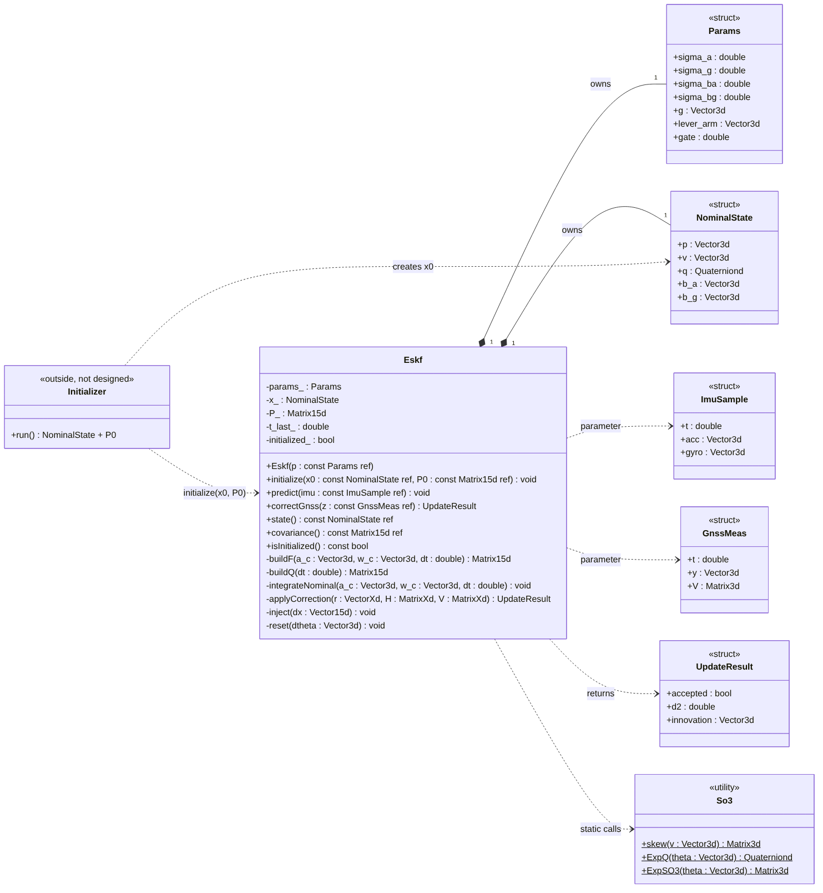
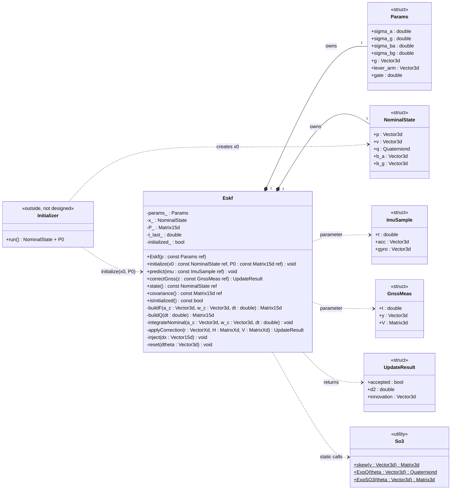

# ESKF — error-state Kalman filter (IMU + GNSS)

Pure C++17 library, no ROS. Fuses a 6-axis IMU (prediction) with GNSS position fixes (correction).
It is the core of the localization pipeline; the ROS 2 node and the LiDAR-to-map update are added on top later.

**Reference:** J. Solà, *Quaternion kinematics for the error-state Kalman filter*, arXiv:1711.02508 —
§5.3 (continuous kinematics), §5.4 (discrete time, F, Q), §6.1 (observation, H = H_x·X_δx), §6.2 (injection),
§6.3 (reset). Equations below are written in my notation; differences from Solà are listed in §2.

| Version | Content | Status |
|---|---|---|
| v1 | IMU predict + GNSS update (gate, Joseph form, lever arm) | in progress |
| v2 | LiDAR-to-map (NDT) pose update `correctPose()` | planned |
| v3 | delayed-measurement buffer, reset Jacobian G | optional |

---

## 1. Design





- `Eskf` remembers only **x (nominal), P, Params, t_last, initialized**. F, Q, H, S, K, δx̂ are locals.
- Structs are plain data; `So3` is stateless math (static); the initializer lives outside and calls `initialize(x0, P0)`.
- `applyCorrection(r, H, V)` holds the sensor-independent part of every update (S, gate, K, Joseph, inject, reset);
  each `correctXxx()` only builds r, H, V.
- Not thread-safe: the caller (ROS node) serializes calls. The caller also runs `predict()` up to a measurement's
  timestamp before calling `correctGnss()` — the filter does not buffer.

---

## 2. Conventions

| item | choice |
|---|---|
| quaternion | Hamilton, (w, x, y, z), `Eigen::Quaterniond`, normalized after every multiply |
| rotation error | local: q_t = q ⊗ Exp(δθ), multiplied on the **right** |
| R | R = R(q) = ^world R_imu (IMU → world) |
| gravity | g = (0, 0, −9.81), constant, not a state (Solà estimates it; dropped here) |
| error state | δp 0–2 · δv 3–5 · δθ 6–8 · δb_a 9–11 · δb_g 12–14  (15) |
| nominal state | p, v, q, b_a, b_g (16 numbers) |
| F inputs | R, b_a, b_g at the **start** of the step → build F before updating the nominal |
| Δt | from timestamps, never hard-coded |
| noise names | Q = process (IMU), V = measurement (GNSS) |
| notation vs Solà | ã, ω̃, b_a, b_g = Solà's a_m, ω_m, a_b, ω_b; Exp(·) = Solà's q{·} |

---

## 3. Equations implemented

### Helpers
```
skew(a) = [  0   −a_z   a_y ;  a_z   0   −a_x ;  −a_y   a_x   0 ]
ExpQ(θ) = [cos(|θ|/2), (θ/|θ|) sin(|θ|/2)]      |θ| < 1e-8 → [1, θ/2], normalize
ExpSO3(θ) = rotation matrix of ExpQ(θ)
```

### Predict — every IMU sample
```
R = R(q)  (old q)      a_c = ã − b_a      ω_c = ω̃ − b_g      Δt = t − t_last

F = I₁₅, then
  F[δp , δv ]  =  I·Δt
  F[δv , δθ ]  = −R·skew(a_c)·Δt
  F[δv , δb_a] = −R·Δt
  F[δθ , δθ ]  =  ExpSO3(−ω_c·Δt)
  F[δθ , δb_g] = −I·Δt

Q = 0, then
  Q[δv]   = σ_a²·Δt·I      Q[δθ]   = σ_g²·Δt·I
  Q[δb_a] = σ_ba²·Δt·I     Q[δb_g] = σ_bg²·Δt·I
  (CARLA per-reading std s: σ²·Δt = (s·Δt)²)

P ← F P Fᵀ + Q

a = R·a_c + g
p ← p + v·Δt + ½·a·Δt²        (old v)
v ← v + a·Δt
q ← (q ⊗ ExpQ(ω_c·Δt)).normalized()
b_a, b_g unchanged
```

### Correct — every GNSS fix (y in map metres, V 3×3, lever arm ℓ)
```
ẑ = p + R·ℓ          r = y − ẑ          H = [ I₃  0  −R·skew(ℓ)  0  0 ]   (3×15)

applyCorrection(r, H, V):
  S  = H P Hᵀ + V
  d² = rᵀ S⁻¹ r ;  d² > gate (7.81, 3 DOF 95 %) → reject, return
  K  = P Hᵀ S⁻¹                              (solve, no explicit inverse)
  δx̂ = K·r
  A  = I − K H ;  P ← A P Aᵀ + K V Kᵀ ;  P ← ½(P + Pᵀ)
  inject:  p += δp̂   v += δv̂   q ← (q ⊗ ExpQ(δθ̂)).normalized()   b_a += δb̂_a   b_g += δb̂_g
  reset:   δx̂ = 0 ;  P ← G P Gᵀ with G ≈ I  (v1)
```

### Guards
- `predict()` before `initialize()` → only store `t_last`.
- Δt ≤ 0 → skip; Δt > 5× nominal → warn and clamp.
- Params checked in the constructor (σ > 0, gate > 0).

---

## 4. Build and test

```bash
cd eskf
cmake -S . -B build
cmake --build build -j
ctest --test-dir build --output-on-failure
```
Needs Eigen 3.3+ (`sudo apt install libeigen3-dev`). GTest is used from the system if present
(`libgtest-dev`), otherwise downloaded by CMake.

| # | Test file | Checks | Pass |
|---|---|---|---|
| 1 | `test_so3.cpp` | Exp(0) = I · 90° yaw · skew(a)·v = a × v · tiny-angle branch | 1e-12 |
| 2 | `test_nominal.cpp` | level still (0,0,9.81) · tilted 10° still · yaw 0.1 rad/s for 1 s → 5.73° · sheet example: p_y 10.0250125, v_y 5.005, yaw 90.057° | p, v unchanged / values |
| 3 | `test_jacobian.cpp` | F vs numerical Jacobian: nudge each of 15 error states by 1e-6 | max diff ≈ 1e-6 |
| 4 | `test_predict.cpp` | P symmetric, grows, positive definite | eigenvalues > 0 |
| 5 | `test_update.cpp` | 1-axis case P 0.25, V 0.09, P_vp 0.05, r 0.4 → K_p 0.735, δp 0.294, δv 0.0588, P_pp 0.0662 · r = 2 m → gated (d² 11.8) | values |
| 6 | `test_synthetic.cpp` | simulated truth + noisy IMU/GNSS | error inside ±2σ ~95 %, NEES ≈ 15 |

---

## 5. Progress (one commit per row)

- [ ] build: CMake + GTest skeleton, setup test passes
- [ ] types + params + So3, test 1
- [ ] integrateNominal, test 2
- [ ] buildF, test 3
- [ ] buildQ + predict, test 4
- [ ] applyCorrection + correctGnss, test 5
- [ ] synthetic run, test 6 → tag `eskf-v1`
- [ ] offline run on a CARLA bag (CSV) → first error plot
