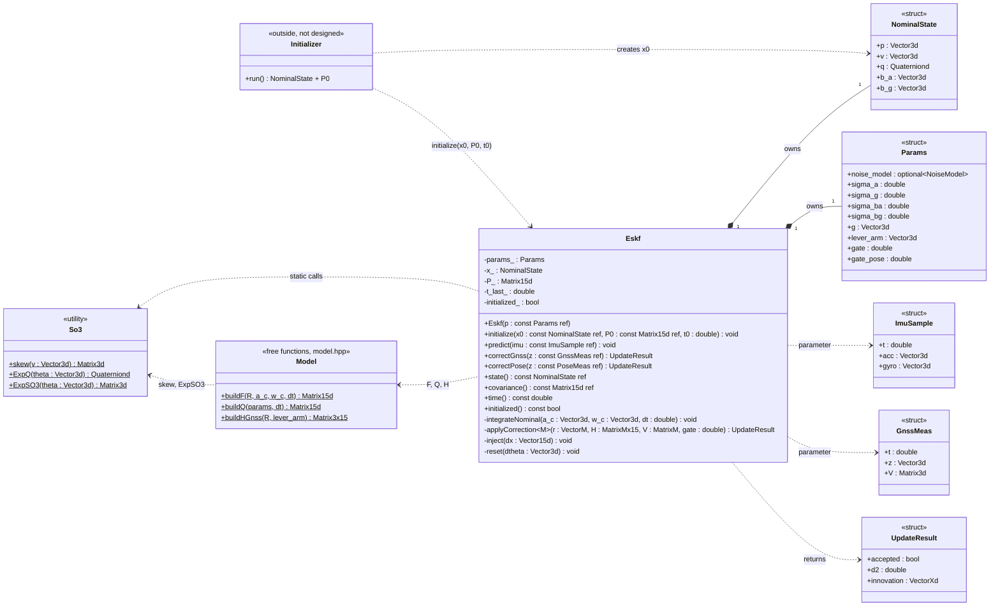

# ESKF — error-state Kalman filter (IMU + GNSS)

Pure C++17 library, no ROS. Fuses a 6-axis IMU (prediction) with GNSS position fixes (correction).
It is the core of the localization pipeline; the ROS 2 node and the LiDAR-to-map update are added on top later.

**Reference:** J. Solà, *Quaternion kinematics for the error-state Kalman filter*, arXiv:1711.02508 —
§5.3 (continuous kinematics), §5.4 (discrete time, F, Q), §6.1 (observation, H = H_x·X_δx), §6.2 (injection),
§6.3 (reset). Equations are in [docs/math.md](docs/math.md), in my notation; differences from Solà are listed in §2.

| Version | Content | Status |
|---|---|---|
| v1 | IMU predict + GNSS update (gate, Joseph form, lever arm, reset Jacobian G) | in progress |
| v2 | LiDAR-to-map pose update `correctPose()` (6-DoF pose of the IMU, math.md §8.7) | implemented |
| v3 | delayed-measurement buffer | optional |

---

## 1. Design



- `Eskf` remembers only **x (nominal), P, Params, t_last, initialized**. F, Q, H, S, K, δx̂ are locals.
- Structs are plain data; `So3` is stateless math (static); the initializer lives outside and calls `initialize(x0, P0, t0)`.
- `applyCorrection(r, H, V)` holds the sensor-independent part of every update (S, gate, K, Joseph, inject, reset);
  each `correctXxx()` only builds r, H, V.
- Not thread-safe: the caller (ROS node) serializes calls. The caller also runs `predict()` up to a measurement's
  timestamp before calling `correctGnss()` — the filter does not buffer.

---

## 2. Conventions

| item | choice |
|---|---|
| quaternion | Hamilton, (w, x, y, z), `Eigen::Quaterniond`, normalized after every multiply |
| rotation error | local: q_t = q ⊗ Exp(δθ), multiplied on the **right** |
| R | R = R(q) = ^world R_imu (IMU → world) |
| gravity | g = (0, 0, −9.81), constant, not a state (Solà estimates it; dropped here) |
| error state | δp 0–2 · δv 3–5 · δθ 6–8 · δb_a 9–11 · δb_g 12–14  (15) |
| nominal state | p, v, q, b_a, b_g (16 numbers) |
| F inputs | R, b_a, b_g at the **start** of the step → build F before updating the nominal |
| Δt | from timestamps, never hard-coded |
| noise names | Q = process (IMU), V = measurement (GNSS) |
| notation vs Solà | ã, ω̃, b_a, b_g = Solà's a_m, ω_m, a_b, ω_b; Exp(·) = Solà's q{·}; z (measurement) = Solà's y |

---

## 3. Equations implemented

Full derivation: [docs/math.md](docs/math.md)

---

## 4. Build and test

```bash
cd eskf
cmake -S . -B build
cmake --build build -j
ctest --test-dir build --output-on-failure
```
Needs Eigen 3.4.0+ (`sudo apt install libeigen3-dev`). GTest is used from the system if present
(`libgtest-dev`), otherwise downloaded by CMake.

| # | Test file | Checks | Pass |
|---|---|---|---|
| 1 | `test_so3.cpp` | Exp(0) = I · 90° yaw · skew(a)·v = a × v · tiny-angle branch | 1e-12 |
| 2 | `test_nominal.cpp` | level still (0,0,9.81) · tilted 10° still · yaw 0.1 rad/s for 1 s → 5.73° · sheet example: p_y 10.0250125, v_y 5.005, yaw 90.057° | p, v unchanged / values |
| 3 | `test_jacobian.cpp` | F vs numerical Jacobian: nudge each of 15 error states by 1e-6 | < 1e-6 at Δt 1e-4 · < 2e-4 at 200 Hz (F drops the ½·a·Δt² terms) |
| 4 | `test_predict.cpp` | P symmetric, grows, positive definite | eigenvalues > 0 |
| 5 | `test_update.cpp` | 1-axis case P 0.25, V 0.09, P_vp 0.05, r 0.4 → K_p 0.735, δp 0.294, δv 0.0588, P_pp 0.0662 · r = 2 m → gated (d² 11.8) | values |
| 6 | `test_synthetic.cpp` | simulated truth + noisy IMU/GNSS | error inside ±2σ ~95 %, NEES ≈ 15 |
| 7 | `test_model.cpp` | Q entries for both noise models · H blocks · buildQ rejects an unset noise model | values |

---

## 5. Progress (one commit per row)

- [x] build: CMake + GTest skeleton, setup test passes
- [x] types + params + So3, test 1
- [x] integrateNominal, test 2
- [x] buildF, test 3
- [x] buildQ + predict, test 4
- [x] applyCorrection + correctGnss, test 5
- [ ] synthetic run, test 6 → tag `eskf-v1`
- [ ] offline run on a CARLA bag (CSV) → first error plot
