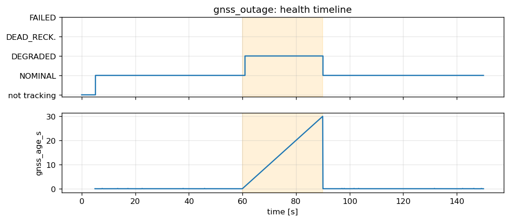
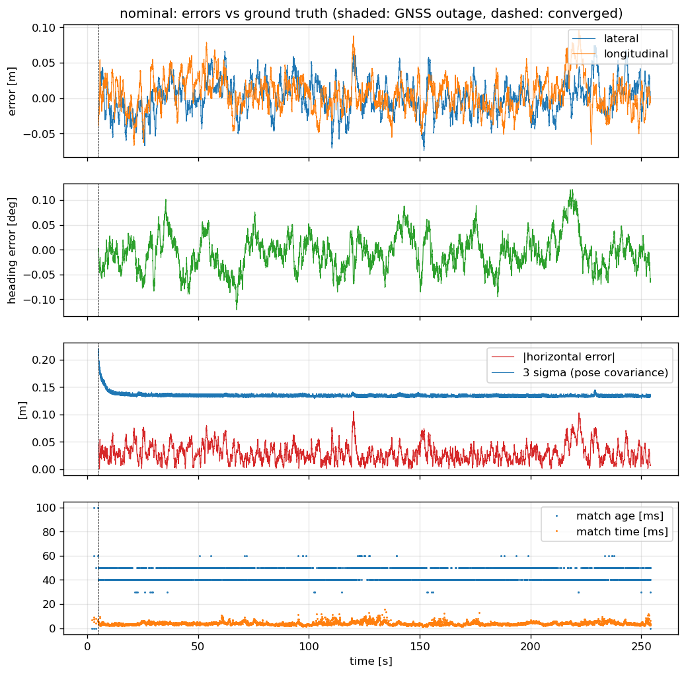

# Results

The six scenarios run live in CARLA 0.9.15 (1.0x real time, 10 ms tick) with `localization_node` beside them on the
final code. One run per scenario, recorded by `eval/run_live.sh <scenario> final_<scenario> --outputs-only` and
evaluated by `eval/loc_metrics.py` against `/eval/ground_truth`. Hardware: Intel i7-13650HX, RTX 4060 8 GB.
No viewer was connected during these runs (see [Known issues](#known-issues)).

The other folders here are earlier runs (replays, tuning, the first live batch); `summary.md` lists all of them.

## All scenarios

Errors are in the ground-truth heading frame and cover the run from the convergence time on. p95 / max.

| scenario | checks | lateral [m] | longitudinal [m] | horizontal [m] | heading [deg] | APE RMSE [m] | convergence [s] | output latency p99 [ms] |
|---|---|---|---|---|---|---|---|---|
| [nominal](final_nominal/summary.md) | pass 5/5 | 0.046 / 0.074 | 0.049 / 0.096 | 0.061 / 0.106 | 0.070 / 0.122 | 0.045 | 5.15 | 0.22 |
| [gnss_outage](final_gnss_outage/summary.md) | pass 9/9 | 0.046 / 0.074 | 0.046 / 0.090 | 0.058 / 0.108 | 0.068 / 0.121 | 0.045 | 5.13 | 0.24 |
| [relocalization](final_relocalization/summary.md) | pass 6/6 | 0.048 / 0.074 | 0.048 / 0.106 | 0.061 / 0.111 | 0.085 / 0.144 | 0.043 | 3.42 | 0.22 |
| [dense_traffic](final_dense_traffic/summary.md) | pass 5/5 | 0.041 / 0.096 | 0.045 / 0.098 | 0.055 / 0.102 | 0.083 / 0.152 | 0.042 | 5.21 | 0.27 |
| [high_speed_turns](final_high_speed_turns/summary.md) | pass 5/5 | 0.044 / 0.118 | 0.053 / 0.094 | 0.062 / 0.133 | 0.080 / 0.125 | 0.044 | 11.51 | 0.23 |
| [reverse_reuse](final_reverse_reuse/summary.md) | pass 5/5 | 0.034 / 0.144 | 0.084 / 0.106 | 0.090 / 0.149 | 0.110 / 0.133 | 0.051 | 11.95 | 0.25 |

Thresholds (`eval/loc_metrics.py`, from Reid et al., "Localization Requirements for Autonomous Vehicles", SAE
Int. J. CAV 2019, freeway passenger car):

| metric | threshold |
|---|---|
| lateral p95 | 0.20 m |
| longitudinal p95 | 0.48 m |
| heading p95 | 0.5 deg (high_speed_turns: 1.0 deg in the fast parts; measured 0.071) |
| horizontal max | 0.57 m (lateral alert limit) |
| output latency p99 | 20 ms (one 50 Hz output period) |
| relocalization convergence | 10 s from `/initialpose` |
| outage peak drift | 0.57 m |
| NOMINAL after the outage | 5 s |

- **Convergence**: the first time from which the horizontal error stays under 0.5 m and the heading error under
  2 deg for 3 s, counted from the first IMU sample (relocalization: from `/initialpose`, 5 m / 30 deg off). It
  includes the 5 s standing start of every scenario; only relocalization has a convergence threshold.
- **Output latency**: recorder receive time of `/localization/pose` minus that of the `/imu/data` sample with the
  same stamp, both on one recorder clock.
- **Match time**: VGICP alignment p95 5.7 to 7.9 ms per sweep across the scenarios (20 Hz sweeps).

## GNSS outage

GNSS is withheld from 60.0 s to 89.9 s of the run (`/gnss/fix_gated`); LiDAR matching continues.

| metric | value | threshold |
|---|---|---|
| peak horizontal drift in the outage | 0.072 m | 0.57 m |
| position sigma, max in the outage | 0.049 m | - |
| health in the outage | DEGRADED for 100 % of the window (60.94 to 89.94 s) | DEGRADED throughout |
| back to NOMINAL after GNSS returns | 0.13 s | 5 s |
| FAILED status messages | 0 | 0 |

Health timeline: INITIALIZING 0 to 5.0 s, TRACKING NOMINAL 5.1 to 60.8 s, TRACKING DEGRADED 60.9 to 89.9 s,
TRACKING NOMINAL 90.0 s to the end.

## Plots per scenario

Each folder holds `trajectory.png` (top view against ground truth), `errors.png` (lateral, longitudinal, heading
over time), `health.png` (lifecycle, health, sigma), `nis.png` (pose NIS), `metrics.json` and `summary.md`;
high_speed_turns also has `dynamics.png` (speed, yaw rate, lateral acceleration).

| scenario | trajectory | errors | health | NIS |
|---|---|---|---|---|
| nominal | [png](final_nominal/trajectory.png) | [png](final_nominal/errors.png) | [png](final_nominal/health.png) | [png](final_nominal/nis.png) |
| gnss_outage | [png](final_gnss_outage/trajectory.png) | [png](final_gnss_outage/errors.png) | [png](final_gnss_outage/health.png) | [png](final_gnss_outage/nis.png) |
| relocalization | [png](final_relocalization/trajectory.png) | [png](final_relocalization/errors.png) | [png](final_relocalization/health.png) | [png](final_relocalization/nis.png) |
| dense_traffic | [png](final_dense_traffic/trajectory.png) | [png](final_dense_traffic/errors.png) | [png](final_dense_traffic/health.png) | [png](final_dense_traffic/nis.png) |
| high_speed_turns | [png](final_high_speed_turns/trajectory.png) | [png](final_high_speed_turns/errors.png) | [png](final_high_speed_turns/health.png) | [png](final_high_speed_turns/nis.png) |
| reverse_reuse | [png](final_reverse_reuse/trajectory.png) | [png](final_reverse_reuse/errors.png) | [png](final_reverse_reuse/health.png) | [png](final_reverse_reuse/nis.png) |

## Known issues

### Late sweeps in live runs with a viewer connected

With Foxglove connected to `foxglove_bridge` during a live CARLA run, sweeps reach the localizer late: the match
age (filter time minus sweep end) grows. Relocalization, live:

| viewer | match age p50 / p99 / max [ms] | result |
|---|---|---|
| none | 50 / 60 / 90 | converged 3.4 s, lateral p95 0.046 m |
| Foxglove, viewer map at 1 m voxels | 60 / 770 / 780 | grows at 60 to 85 s, recovers; lateral p95 0.154 m |
| Foxglove, viewer map at 2 m voxels | 70 / 750 / 770 | same window; lateral p95 0.149 m |
| Foxglove, map hidden | 70 / 1198 / 1220 | late from the start, GNSS fixes late too; never reached TRACKING |
| Foxglove on a replayed bag (no CARLA) | 20 / 30 / 50 | no growth |

In every viewer run the node processed every sweep (about 20 per second, alignment under 10 ms) and the IMU
stayed current (10 to 20 ms old) while the sweeps arrived late, so the delay is upstream of the localizer, on
the simulator and bridge side. It needs CARLA running and does not depend on the size of the viewer map. Where it
enters is not yet measured. Live runs are made without a viewer; watch a replay instead.

### Slow starts in high_speed_turns and reverse_reuse

Both reach TRACKING after about 11.5 s instead of 3 to 5 s. During the standing start the heading search finds
the right pose (lead of the best over the second pose 0.13 to 0.32 in error per inlier), but the 5 confirmation
matches fail six times on error per inlier (0.13 to 0.42 against the 0.12 limit). The start is confirmed once
the car drives, with the GNSS-derived initial speed within 0.25 m/s of ground truth (15.1 and 7.8 m/s). No
check bounds the start time in these scenarios; the confirmation rule (for example 5 accepted of 7) is open.

### Conservative pose NIS

The mean pose NIS is 0.04 to 0.07 in all six runs, with no update above the 6-DoF 95 % bound; a consistent filter
would average about 6. The filter runs with ten times the CARLA IMU noise (to cover the jolts at curbs that
locked out dense_traffic before), and the pose measurement floor is 0.15 m / 0.025 rad. Both overstate the
uncertainty; accuracy is not affected, but the reported covariance is pessimistic.
