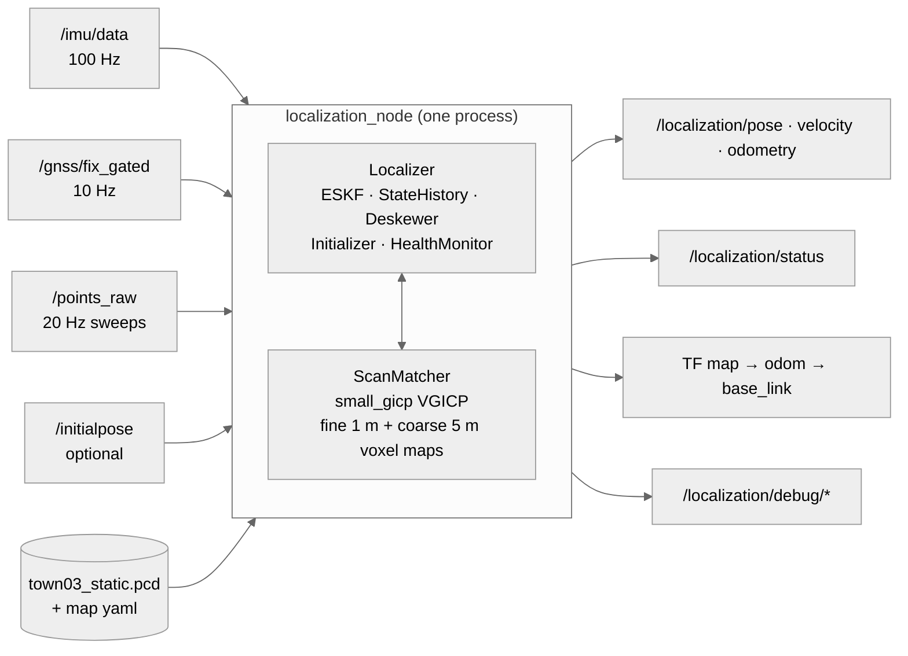

# brightdrive_localization

Online localization of the car on the map built by `mapping/brightdrive_mapping` (`town03_static.pcd`). An ESKF
fuses IMU, GNSS and LiDAR-to-map matching in one ROS 2 C++ node, `localization_node`. The estimation code is a
ROS-free library (`loc_core`); the node converts messages, runs the threads and publishes.

All six scenarios pass live in CARLA; see [Scenarios and results](#scenarios-and-results), plots in
[`eval/results/README.md`](../eval/results/README.md).

## Requirements

| Task requirement | Section |
|---|---|
| 1. IMU + GNSS + LiDAR-to-map matching in ROS 2 C++ | [Pipeline](#pipeline) |
| 2. Estimator: state, prediction, GNSS and LiDAR updates, uncertainty | [Estimator](#estimator) |
| 3. Pose, velocity, status, covariance and TF at fixed rates | [Topics and TF](#topics-and-tf) |
| 4. No ground truth in the estimator | [Ground truth](#ground-truth) |
| 5. Start from 5 m / 30° off: method and convergence criteria | [Initialization](#initialization) |
| 6. Health: nominal, degraded, dead reckoning, failed; GNSS outage and recovery | [Health](#health) |
| 7. Topics, types, rates, QoS, TF tree | [Topics and TF](#topics-and-tf) |
| 8. Input age, processing time, output latency, no accumulation at 1x | [Latency](#latency) |
| 9. Diagnostics without flooding the console | [Diagnostics and logging](#diagnostics-and-logging) |
| 10. YAML parameters | [Parameters](#parameters) |
| 11. Build, launch, run a scenario, viewer | [How to run](#how-to-run) |
| 12. Scenarios, thresholds, results | [Scenarios and results](#scenarios-and-results) |
| 13. Dependencies and what I wrote | [Dependencies](#dependencies) |
| 14. Known limitations | [Known limitations](#known-limitations) |

## Pipeline



Threads:

- ROS executor: the IMU, GNSS and `/initialpose` callbacks, IMU prediction, the outputs on every 2nd IMU sample,
  the status timer.
- Matcher thread: takes the newest sweep from a one-deep slot; deskew, preprocess, VGICP align and pose update, or
  the initialization search while there is no filter.
- Cloud thread, only with `debug_clouds: true`: publishes the aligned scan.

One mutex (`Localizer::mtx_`) guards the filter; deskew, preprocess and align run without it. The sweep path step
by step: [docs/pointcloud_path.md](docs/pointcloud_path.md).

Classes (`include/brightdrive_localization/`):

- `Localizer`: owns the ESKF, the history, lifecycle and health; `onImu`, `onGnss`, `onInitialPose`,
  `processScan`, `output`.
- `ScanMatcher`: small_gicp VGICP. `preprocess` crops to 3–100 m, downsamples to 0.5 m voxels and estimates
  per-point covariances from 10 neighbours; `align` runs on the fine (1 m) or coarse (5 m) voxel map.
- `StateHistory`: the last 3 s of raw IMU/GNSS events and filter poses, for deskew, late measurements and the
  initialization's still window.
- `Deskewer`: moves every point to the sweep end with the filter's poses, one transform per distinct point time.
- `Initializer`: stateless; GNSS velocity, still test, heading search, x0 and P0.
- `HealthMonitor`: the health level from accepted and gated updates, their ages and σ_pos.

## Estimator

The filter is `eskf/`, my error-state Kalman filter after Solà (arXiv:1711.02508). Equations in
[`eskf/docs/math.md`](../eskf/docs/math.md), API in [`eskf/README.md`](../eskf/README.md).

**State.** Nominal x = (p, v, q, b_a, b_g), 16 numbers: IMU position, velocity and orientation in `map`, biases
in IMU axes. Error state δx = (δp, δv, δθ, δb_a, δb_g), 15 numbers; δθ is a rotation error on the right (body
axes). base_link = IMU (`T_base_imu` is the identity).

**Prediction**, at every IMU sample (100 Hz): a = R(ã − b_a) + g, p += vΔt + ½aΔt², v += aΔt,
q ← q ⊗ Exp((ω̃ − b_g)Δt), biases constant; P ← F P Fᵀ + Q.

**GNSS update** (10 Hz, 3 DoF): r = z − (p + R·lever), lever arm (0, 0, 1.8) m. R is the fix covariance,
diag(0.3²) m² when the fix has none. A late fix is shifted by the filter's displacement since its stamp; a fix
newer than the filter waits until prediction reaches it.

**LiDAR pose update** (up to 20 Hz, 6 DoF): the deskewed sweep is aligned on the fine map, starting from the
predicted pose. The match is the IMU pose at the sweep end t_ref, which is in the past when the match is applied,
so it is moved to now with the filter's own motion: T_meas(now) = T_meas(t_ref) · T_hist(t_ref)⁻¹ · T_now.
Residual r = (p_meas − p, Log(q⁻¹ ⊗ q_meas)). After an accepted update, every stored pose from t_ref on gets the
same correction, so the next sweep does not apply it again.

A match is used only if, in this order: ≥ 1000 points after preprocessing, converged, error per inlier ≤ 0.12,
inlier ratio ≥ 0.6, the filter pose at t_ref still in the history, within 3 m and 0.2 rad of it, age ≤ 0.2 s,
and finally the χ² gate. The first failure is the reject code (`match.*` in the status).

**Uncertainty.**

- Q: per IMU reading, σ_a 0.5 m/s² and σ_g 0.05 rad/s, ten times the CARLA sensor noise, to cover the curb jolts
  at corners; bias random walks 1e-4 m/s²/√s and 1e-5 rad/s/√s.
- R: GNSS from the fix. LiDAR fixed, σ 0.15 m and 0.025 rad (`meas.*`); the VGICP Hessian is not used.
- Gates on d² = rᵀS⁻¹r: GNSS 11.34 (χ², 3 DoF, 99 %), pose 22.46 (χ², 6 DoF, 99.9 %, loose while R is fixed).
  A gated update leaves the state untouched and counts toward the gate lock-out in [Health](#health).
- Published covariance (`Localizer::output`): the pose covariance is P's position and rotation blocks moved to
  base_link and rotated to map axes; the twist covariance comes from the velocity and attitude blocks, plus one
  gyro reading's noise and the gyro-bias block for the angular rate.

## Ground truth

The estimator does not read ground truth. CARLA ground truth and the other evaluation data are published only on
`/eval/*`: `/eval/ground_truth` (`eval/gt_publisher.py`), `/eval/gnss_outage` (`sim/gnss_gate`) and
`/eval/init_offset` (`eval/initial_pose_publisher.py`). They are read by the `eval/` scripts and by `match_bag`,
an offline tool in `tools/` that tests the matcher alone against ground truth on a bag; it is not part of the node.

How this is kept: no `/eval` topic name appears in `src/` or `include/`, and `ros2 node info /localization_node`
during a live run lists no `/eval` subscription ([`eval/results/gt_isolation.txt`](../eval/results/gt_isolation.txt)).
The relocalization `/initialpose` is the route waypoint plus the scenario offset, not ground truth.

## Initialization

The ESKF needs a full x0 and P0; the hard part is heading, which neither a standing IMU nor GNSS gives. The
initializer runs on each sweep while no filter exists (node start, failed confirmation, health FAILED):

1. Position seed: a GNSS fix at most 1 s old with σ ≤ 2 m. Without one, `/initialpose`, if the car has been still
   since its stamp.
2. Velocity: a least-squares fit to the GNSS fixes of the last 1 s. A still test on the last 2 s of IMU and the
   GNSS speed decides between v0 = 0 with b_g = gyro mean (still) and v0 from the fit (moving).
3. Heading: all 36 headings (10° apart) at the seed on the coarse 5 m map; the 3 best distinct poses are refined
   on the fine 1 m map and ranked by error per inlier. The winner must pass the tracking limits (error per inlier
   ≤ 0.12, inlier ratio ≥ 0.6), lead the second distinct pose by 0.1 in error per inlier, and above 5 m/s point
   within 20° of the GNSS course. The `/initialpose` yaw or the GNSS course only sets where the grid starts.
4. The filter starts at the sweep time (σ 0.3 m, 5° yaw, 2° roll and pitch) and replays the buffered IMU and GNSS
   to now.

Convergence criterion: 5 accepted sweeps in a row through the normal update path (`init.confirm_n`), then
TRACKING; one reject discards the filter and the search runs again. Outputs are published only in TRACKING. The
evaluation measures convergence against ground truth: the first time from which the horizontal error stays under
0.5 m and the heading error under 2° for 3 s.

The 5 m / 30° start: in the relocalization scenario GNSS is available, so the position comes from GNSS and the
`/initialpose` (5 m / 30° off) only sets where the heading grid starts; the grid covers 360° either way. Measured:
converged 3.42 s after `/initialpose` (threshold 10 s). A start from the `/initialpose` position, without GNSS,
works only standing. All steps, cases and parameters: [docs/initialization.md](docs/initialization.md).

## Health

Lifecycle: WAIT_DATA → INITIALIZING (first IMU sample) → TRACKING (confirmed start). Health is evaluated after
every IMU sample while TRACKING (`HealthMonitor::evaluate`, filter time). The first rule that matches wins; the
timers start when the filter is initialized.

| # | Health | Rule |
|---|---|---|
| 1 | FAILED | state or covariance not finite |
| 2 | FAILED | 10 gated updates in a row, GNSS or LiDAR; an accepted update resets the count, quality rejects neither count nor reset |
| 3 | FAILED | no accepted update from either source for 5 s |
| 4 | FAILED | σ_pos ≥ 3 m, with σ_pos = √(trace(P_pp) / 3) |
| 5 | NOMINAL | LiDAR accepted within 0.5 s, GNSS accepted within 1 s, σ_pos < 0.5 m |
| 6 | DEGRADED | LiDAR accepted within 0.5 s or GNSS within 1 s: one source, or both with σ_pos ≥ 0.5 m |
| 7 | DEAD_RECKONING | the newest accepted update of either source is older than 1 s (IMU only) |
| 8 | DEGRADED | otherwise: both sources just past their timeouts, one of them under 1 s ago |

FAILED discards the filter and returns to INITIALIZING (`recovering_from_failure: yes`).

GNSS outage: LiDAR keeps matching, so 1 s after the last fix rule 6 gives DEGRADED, and the first accepted fix
afterwards gives NOMINAL again (rule 5). Measured in gnss_outage: DEGRADED for the whole outage (60.94 to 89.94 s),
NOMINAL 0.13 s after GNSS returns, never FAILED. None of the six scenarios removes LiDAR, so DEAD_RECKONING and
FAILED are not exercised by them.

Status level: TRACKING NOMINAL is OK; DEGRADED and DEAD_RECKONING are WARN. Not tracking is STALE, WARN after
10 s of INITIALIZING (`init.timeout_s`), ERROR while recovering from FAILED. No IMU for over 1 s is WARN, over 5 s
ERROR.

## Topics and TF

| Topic | Type | Rate | QoS | Notes |
|---|---|---|---|---|
| in `/imu/data` | `sensor_msgs/Imu` | 100 Hz | sensor data (best effort), depth 200 | prediction; every 2nd sample triggers the outputs |
| in `/gnss/fix_gated` | `sensor_msgs/NavSatFix` | 10 Hz | sensor data (best effort), depth 10 | the outage scenario withholds fixes here |
| in `/points_raw` | `sensor_msgs/PointCloud2` | 20 Hz | best effort, depth 1 | per-point `time` field, stamp = sweep start |
| in `/initialpose` | `geometry_msgs/PoseWithCovarianceStamped` | once | reliable, transient local, depth 1 | optional |
| in `/clock` | `rosgraph_msgs/Clock` | 100 Hz | | `use_sim_time: true` |
| `/localization/pose` | `geometry_msgs/PoseWithCovarianceStamped` | 50 Hz | reliable, depth 10 | base_link in `map`, 6×6 covariance |
| `/localization/velocity` | `geometry_msgs/TwistWithCovarianceStamped` | 50 Hz | reliable, depth 10 | base_link axes, 6×6 covariance |
| `/localization/odometry` | `nav_msgs/Odometry` | 50 Hz | reliable, depth 10 | pose and twist in one message |
| `/localization/status` | `diagnostic_msgs/DiagnosticArray` | 10 Hz + each lifecycle change | reliable, depth 10 | see [Diagnostics](#diagnostics-and-logging) |
| `/tf` | `tf2_msgs/TFMessage` | 50 Hz | reliable, depth 100 (tf2_ros default) | `map → odom` and `odom → base_link` |
| `/localization/path` | `nav_msgs/Path` | 2 Hz | best effort, depth 1 | one pose per 0.5 s, newest 2000 |
| `/localization/map` | `sensor_msgs/PointCloud2` | once | reliable, transient local | viewer copy at 2 m voxels |
| `/localization/debug/health` | `std_msgs/Float64MultiArray` | with the status | reliable, depth 10 | 11 numbers |
| `/localization/debug/match` | `std_msgs/Float64MultiArray` | per matched sweep | reliable, depth 50 | 10 numbers, `debug_metrics` |
| `/localization/debug/aligned_scan` | `sensor_msgs/PointCloud2` | ≤ 5 Hz | best effort, depth 1 | `debug_clouds` (off by default) |

Pose, velocity, odometry and TF are published on every 2nd IMU sample (`output_every_n_imu: 2`), only in
TRACKING, stamped with the filter time (the IMU stamp).

| Transform | Publisher | Rate | Content |
|---|---|---|---|
| `map → odom` | `localization_node`, `/tf` | 50 Hz | (filter pose) · (odom → base_link)⁻¹: carries every correction |
| `odom → base_link` | `localization_node`, `/tf` | 50 Hz | the accumulated prediction steps only: continuous, never jumps |
| `base_link → lidar` | `carla_bridge`, `/tf_static` | once | (0, 0, 1.9) m, no rotation |
| `base_link → imu` | `carla_bridge`, `/tf_static` | once | identity |
| `base_link → gnss` | `carla_bridge`, `/tf_static` | once | (0, 0, 1.8) m, no rotation |

Both localization transforms go out in one message with one stamp. `odom` equals `map` when the filter is
initialized. The localizer takes its extrinsics from `localization.yaml`, not from `/tf_static`; the values are
those of `sim/config/sensors.yaml`.

## Latency

Final live runs, six scenarios at 1.0x real time ([`eval/results/`](../eval/results/README.md)):

| Measure | Source | Measured |
|---|---|---|
| input age: filter time − sweep end when the match is applied | status `match_age_ms` | p50 40–50 ms, p99 50–130 ms, max 210 ms (dense_traffic) |
| processing: VGICP align per sweep | status `match_time_ms` | p50 3.8–4.4 ms, p95 5.7–7.9 ms, p99 7.2–10.8 ms |
| output latency: `/imu/data` received → `/localization/pose` received, recorder clock | `eval/loc_metrics.py` | p99 0.22–0.27 ms |
| output latency in the node: IMU callback entry → outputs published | status `output_latency_ms` | p99 0.14–0.19 ms |

Latency does not accumulate at 1x: in every run the input age p50 of the last third is within 10 ms (one IMU
tick, the resolution of the age) of the first third, and the alignment p99 is at most 10.8 ms of the 50 ms
between sweeps.

The LiDAR rate is kept without a queue: the subscription is best effort with depth 1, and the callback only puts
the message into a one-deep slot. A sweep that arrives while the matcher is busy replaces the waiting one
(`sweeps_dropped_busy`), so the newest sweep always wins. In the final runs 0.6–3.7 % of the sweeps were dropped
this way, and 20 % in reverse_reuse (172 of 855 in a 31 s run with 8 initialization searches).
Details: [docs/pointcloud_path.md](docs/pointcloud_path.md).

## Diagnostics and logging

Published:

- `/localization/status`: one `DiagnosticStatus` named `localization` with a level (see [Health](#health)), a
  message (`TRACKING NOMINAL`, `initializing: <step>`) and 56 key-values: lifecycle and health, the
  initialization progress (`init`, `init_last_search`, `time_to_tracking_s`), the last update (`nis_pose`,
  `nis_pose_mean`, `nis_gnss`, `error_per_inlier`, `inlier_ratio`, `match_time_ms`, `match_age_ms`), the ages
  (`gnss_age_s`, `scan_age_s`, `imu_age_s`), `sigma_pos_m`, `sigma_yaw_deg`, counters (reject codes `match.*`,
  `gnss.*`, sweeps received, dropped and skipped) and `output_latency_ms`. 10 Hz on the node clock, and at once on
  every lifecycle change.
- `/localization/debug/health`, published with the status, for plots: 0 lifecycle (0 wait, 1 init, 2 tracking),
  1 health (0 nominal, 1 degraded, 2 dead reckoning, 3 failed, −1 not tracking), 2 σ position [m], 3 GNSS age [s],
  4 pose d², 5 error per inlier, 6 match age [ms], 7 consecutive gated, 8 scan age [s], 9 GNSS d², 10 σ yaw [deg].
- `/localization/debug/match` (`debug_metrics: true`), per matched sweep: 0 sweep end time, 1 align time [ms],
  2 inliers, 3 source points, 4 inlier ratio, 5 error per inlier, 6 d², 7 result (2 started, 1 accepted,
  0 rejected), 8 reject code, 9 age [ms].
- `/localization/debug/aligned_scan` (`debug_clouds: true`): the matched sweep in `map`, at most 5 Hz, only while
  someone subscribes, from its own thread.

Console: every parameter and the map load at startup; one line per `/initialpose` received and per filter start;
a sweep that cannot be converted logs an error at most once per 5 s. Nothing is logged per IMU sample, fix or
sweep.

## Parameters

All values are in [`config/localization.yaml`](config/localization.yaml), one file for every scenario. Core keys
have no default in the code: a missing key stops the node with its name. Every value is logged at startup. The
main ones:

| Key | Value | Role |
|---|---|---|
| `output_every_n_imu` | 2 | 100 Hz IMU → 50 Hz outputs |
| `status_rate_hz` | 10.0 | status and health array |
| `eskf.sigma_a`, `eskf.sigma_g` | 0.5 m/s², 0.05 rad/s | process noise per IMU reading |
| `eskf.gate`, `eskf.gate_pose` | 11.34, 22.46 | χ² gates, GNSS and LiDAR pose |
| `meas.sigma_pos_m`, `meas.sigma_rot_rad` | 0.15, 0.025 | LiDAR pose R |
| `matcher.map_voxel_m`, `matcher.coarse_voxel_m` | 1.0, 5.0 | fine (tracking) and coarse (initial search) voxel maps |
| `matcher.source_leaf_m`, `matcher.max_corr_dist_m`, `matcher.max_iterations` | 0.5, 1.0, 50 | sweep downsampling, correspondence distance, iterations |
| `accept.min_source_points`, `accept.max_error_per_inlier`, `accept.min_inlier_ratio` | 1000, 0.12, 0.6 | match quality |
| `accept.max_jump_m`, `accept.max_jump_rad`, `accept.max_age_s` | 3.0, 0.2, 0.2 | match against the prediction, age |
| `scan.imu_wait_s` | 0.02 | wall time a sweep waits for the IMU sample at its end |
| `history.keep_s` | 3.0 | event and pose history |
| `init.yaw_steps`, `init.confirm_n` | 36, 5 | heading grid, confirmation |
| `health.*` | see [Health](#health) | timeouts and σ limits |
| `debug_metrics`, `debug_clouds` | true, false | debug topics |
| `points.time_field`, `points.time_scale`, `points.stamp_is` | `time`, 1.0, `start` | per-point time, for other LiDARs |

The `init.*` keys: [docs/initialization.md](docs/initialization.md#parameters-localizationyaml-init).

## How to run

Build from a fresh clone, with the map files in `MAPS_DIR` ([mapping README](../mapping/brightdrive_mapping/README.md#maps)):

```
docker compose build loc          # Humble, small_gicp, PCL, GeographicLib, evo
docker compose up -d loc
docker compose exec loc bash      # inside, repo mounted at /ws/src/brightdrive_localization:
colcon build                      # eskf/ and localization/ (docker/colcon_defaults_loc.yaml)
source install/setup.bash
```

The localizer alone, for a live CARLA run or a bag played separately:

```
ros2 launch brightdrive_localization localization.launch.py [params_file:=<yaml>] [rviz:=true]
```

One live scenario, from the repo root on the host. It starts the loc container and the CARLA server if needed,
runs the localizer beside the scenario, records, and writes metrics and plots to `eval/results/<run_name>/`:

```
eval/run_live.sh <scenario> <run_name>                  # the scenario's recorder: sensors, outputs, TF, /eval/*
eval/run_live.sh <scenario> <run_name> --outputs-only   # outputs, status, TF, IMU, /eval/*; used for the results
```

The CARLA server and the sim image are set up as in the top-level README ([Simulation](../README.md#simulation)).

Viewer: import [`foxglove/localization_layout.json`](foxglove/localization_layout.json) into Foxglove. It has a
3D view (map, aligned scan, path, pose), "State" (lifecycle, health and init step as bands), "Update check (d²)"
(pose and GNSS d² with their gates 22.46 and 11.34) and "Uncertainty" (σ position, σ yaw). The aligned scan
needs `debug_clouds: true`. Connect to the `foxglove_bridge` the scenario starts on port 8765, or open a recorded
bag. A viewer connected to a live run delays the sensor input upstream of the node (match age p99 up to
1.2 s against 60 ms without), so the scored runs use no viewer; watch a recorded bag instead. RViz: `rviz:=true` (`rviz/localization.rviz`).

## Scenarios and results

Thresholds (`eval/loc_metrics.py`) for every scenario, from Reid et al., "Localization Requirements for Autonomous
Vehicles" (SAE Int. J. CAV 2019, freeway passenger car): lateral p95 ≤ 0.20 m, longitudinal p95 ≤ 0.48 m,
horizontal max ≤ 0.57 m (the lateral alert limit); heading p95 ≤ 0.5° (0.17 m lateral at 20 m look-ahead); output
latency p99 ≤ 20 ms (one 50 Hz output period).

| Scenario | Setup (`sim/config/sim.yaml`) | Extra checks | Result |
|---|---|---|---|
| nominal | main route, 8 m/s, no traffic | — | PASS 5/5, lateral p95 0.046 m |
| gnss_outage | no GNSS from 60 s for 30 s | drift in the outage ≤ 0.57 m, DEGRADED throughout, NOMINAL ≤ 5 s after, never FAILED | PASS 9/9, drift 0.072 m, NOMINAL after 0.13 s |
| relocalization | starts mid-route, `/initialpose` 5 m / 30° off | convergence ≤ 10 s | PASS 6/6, converged in 3.42 s |
| dense_traffic | 40 traffic vehicles | — | PASS 5/5, lateral p95 0.041 m |
| high_speed_turns | 15 m/s on straights, 8 m/s in turns, two lane changes | heading p95 ≤ 1.0° in the fast parts, instead of 0.5° | PASS 5/5, heading p95 0.071°, horizontal max 0.133 m |
| reverse_reuse | the reserved section, against the mapping direction | — | PASS 5/5, lateral p95 0.034 m, longitudinal p95 0.084 m |

The extra limits: the alert limit also holds while GNSS is gone; a few fixes are enough to re-confirm NOMINAL; a bad
initial pose must be corrected within 10 s of data. One run per scenario, with no viewer; the full tables, the
outage health timeline and the plots are in [`eval/results/README.md`](../eval/results/README.md).

## Dependencies

Pinned in the `loc` image (`docker/Dockerfile`, list in `/opt/VERSIONS.txt`):

- ROS 2 Humble (`ros:humble-ros-base-jammy`, pinned by digest): rclcpp 16.0.21, tf2_ros 0.25.24, diagnostic_msgs
  4.9.2; rosbag2_cpp for `match_bag` only.
- [small_gicp](https://github.com/koide3/small_gicp) at `fa0cfc9` (MIT, header-only): VGICP registration, Gaussian
  voxel maps, k-d tree, covariance estimation, voxel downsampling.
- Eigen 3.4.0: all geometry and the filter.
- PCL 1.12.1 (common, io): reads the map PCD.
- yaml-cpp 0.7.0: reads the map yaml, and `localization.yaml` for `match_bag`.
- GeographicLib 1.52: the map's projection, to put GNSS fixes in `map`.
- OpenMP (GCC 11): small_gicp's threads (`matcher.num_threads: 4`).
- evo 1.28.0: APE in `eval/` only.

What I wrote: the ESKF in `eskf/`; everything in `localization/` (Localizer, Initializer, Deskewer, StateHistory,
HealthMonitor, the ScanMatcher wrapper, the node, configuration, launch files, Foxglove layout, `match_bag`;
`geo.cpp` comes from my mapping package); the evaluation in `eval/`. small_gicp and the libraries above are used
unmodified.

## Known limitations

- **Conservative covariance.** Q is ten times the CARLA IMU noise and the LiDAR R is fixed, so the
  reported covariance is pessimistic: the mean pose NIS is 0.04–0.08 against about 6 for a consistent
  filter. Next step: calibrate Q and R from the d² statistics.
- **No degeneracy model.** The LiDAR R is the same in a straight corridor as in a rich scene; the VGICP
  Hessian is computed but not used, so weak directions are not inflated.
- **Strict start confirmation.** 5 accepted sweeps in a row are needed, so one rejected sweep discards a
  correct start. This is why high_speed_turns and reverse_reuse took 11.5 s and 11.9 s to start. A rule
  like "5 of the last 7" would tolerate single rejects.
- **Initialization needs GNSS.** Without GNSS the localizer starts only standing, from `/initialpose`,
  and a re-initialization during a GNSS outage waits for GNSS.
- **The map is assumed static.** It is loaded once and never updated, so large changes in the scene
  (roadworks, parked rows of cars) are not detected and can weaken the matching.
