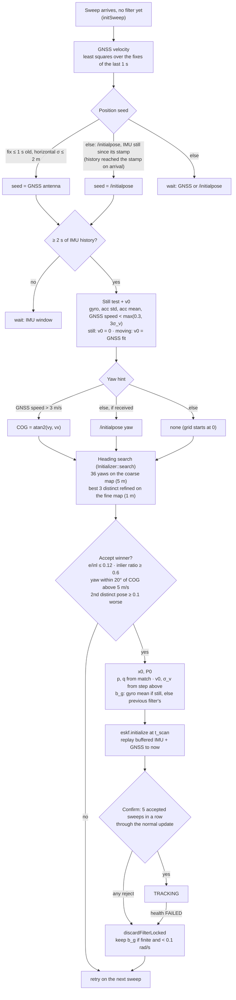

# Initialization

The ESKF only refines a state it already has, so it starts from a full x0 (p, v, q, b_a, b_g) and P0.
`Localizer::initSweep` gathers the inputs and calls `Initializer`, a stateless class with the pure
computations. The hard part is heading: at rest the IMU has no yaw (no magnetometer) and GNSS has no
heading, so the yaw comes from matching the first sweep against the prior map. The same path runs for
a cold start, a moving start and a re-initialization after `FAILED`. Only velocity and gyro bias
depend on the case.

`initSweep` runs on every sweep while no filter exists (`filter_active_ == false`): at node start, after
a failed confirmation, and after health `FAILED`. A search takes about 1 s (0.9–1.1 s in the final runs,
`init_last_search`); sweeps arriving meanwhile are dropped, so there is about one attempt per second.

### Steps

1. **GNSS velocity** (`Initializer::gnssVelocity`). From the fixes (antenna position, map frame) of the
   last `vel_window_s` = 1 s, a least-squares line per horizontal axis:
   v = Σ(tᵢ−t̄)(xᵢ−x̄) / Σ(tᵢ−t̄)², vz = 0. σ_v = σ_fix / √Σ(tᵢ−t̄)², with σ_fix from the NavSatFix
   covariances, floored at 0.2 m/s (≈ 0.33 m/s for 10 fixes). Needs ≥ 5 fixes spanning ≥ 0.5 s, else no
   velocity. Two neighbouring fixes are not used: 0.3 m noise over 0.1 s is ~4 m/s of error. The lever
   arm points straight up, so only roll/pitch rates would separate antenna and IMU velocity; ignored.
2. **Position seed.** A fix at most 1 s old with horizontal σ ≤ 2 m: seed = antenna position, and each
   candidate heading places the IMU at antenna − R·lever. Otherwise `/initialpose`, if the IMU history (3 s)
   reached back to its stamp when it arrived and the IMU part of the still test passes on all samples since
   then (at least 10): seed = that base_link position. Otherwise the status reports `waiting for GNSS or /initialpose (<why>)`.
3. **IMU window.** The history must reach 2 s before the sweep, so a cold start sees the car standing.
4. **Still test and v0** (`stillWindow` → `still`, `initVelocity`). Needs at least 10 IMU samples spanning
   half the window (1 s). Checked in order; the first failure is the reason:
   max |gyro| < 0.05 rad/s · std |acc| < 0.2 m/s² · | mean |acc| − g | < 0.1 m/s² ·
   GNSS speed < max(0.3, 3σ_v) ≈ 0.99 m/s (only when step 1 produced a velocity).
   The IMU alone cannot see constant velocity: a car cruising straight looks like a parked one, and GNSS
   is the only sensor here that measures velocity. The GNSS bound is noise-scaled because a parked car's
   fitted speed is not zero (median 0.55 m/s, max 0.91 m/s on the bags).
   Still: v0 = 0, σ_v 0.5 m/s, b_g = gyro mean. Moving with a GNSS velocity: v0 and σ_v from the fit.
   Moving without one: v0 = 0, σ_v 10 m/s.
5. **Yaw hint.** Course over ground (converted from base_link heading to IMU yaw) when GNSS speed > 3 m/s
   (σ_yaw ≈ σ_v / speed, ~2.4° at 8 m/s), else the `/initialpose` yaw, else none. The hint only sets where
   the grid starts; all 36 headings (10° apart) are always tried.
6. **Search** (`search`). Every heading is aligned on the coarse map (5 m voxels, wide basin); results with
   an inlier ratio below 0.6 are dropped. The 3 best
   distinct poses (distinct = more than 1 m or 5° apart) are refined on the fine map (1 m), which also
   solves roll, pitch and z. Ranked by error per inlier, lower is better; the inlier ratio saturates near
   1.0 and does not separate headings.
7. **Accept.** In order: ≥ 1000 source points · a refined candidate converged · e/inl ≤ 0.12 (the
   tracking limit) · inlier ratio ≥ 0.6 · above 5 m/s, yaw within 20° of COG · the best *different*
   pose at least 0.1 worse in e/inl (guards near-symmetric places). Any failure: `searching (<reason>)`,
   retry on the next sweep.
8. **Birth and catch-up.** `eskf.initialize(x0, P0, t_scan)` at the sweep's time, then the buffered raw
   IMU and GNSS after t_scan are replayed so the filter reaches "now". Lifecycle stays INITIALIZING.
9. **Confirm.** The next sweeps go through the normal deskew → match → update path. 5 accepted in a row
   → TRACKING. Any reject → `discardFilterLocked`, and the search runs again.

### x0 and P0

| Still test | GNSS velocity | v0 | σ_v | b_g |
|---|---|---|---|---|
| still | — | 0 | 0.5 m/s | mean gyro over the 2 s window |
| moving | available | GNSS fit | fit σ (floor 0.2) | previous filter's b_g, else 0 |
| moving | not available | 0 | 10 m/s | previous filter's b_g, else 0 |

p, q come from the winning match in every case. b_a = 0 (not separable from tilt at rest; converges after
turns). A discarded filter's b_g is carried over only if finite and below 0.1 rad/s on every axis. Other
σ: position 0.3 m, roll/pitch 2°, yaw 5°, b_a 0.1 m/s², b_g 0.005 rad/s.

### Cases and results

| # | Situation | Seed | Yaw hint | v0 | b_g | Result |
|---|---|---|---|---|---|---|
| 1 | cold start, standing, GNSS | GNSS | `/initialpose` yaw or none | 0 | gyro mean | final live nominal, gnss_outage, dense_traffic: still, v0 = 0, TRACKING after 5.12–5.19 s. Final relocalization: classified moving at spawn (first limitation below), v0 0.82 m/s, converged 3.42 s after `/initialpose`, lateral p95 0.048 m, heading p95 0.085° |
| 2 | cold start, moving, GNSS | GNSS | COG | GNSS fit | 0 | final live high_speed_turns / reverse_reuse: started while driving, v0 15.10 / 7.76 m/s |
| 2b | cold start inside a hard turn | GNSS | COG | GNSS fit | 0 | the search runs on the raw sweep (no poses to deskew with yet); a sweep that fails the e/inl limit is retried on the next one |
| 3 | re-init after FAILED, moving | GNSS | COG | GNSS fit | previous b_g | implemented, not triggered in tests (no FAILED occurred) |
| 4 | cruising straight (IMU looks still) | GNSS | COG | GNSS fit | previous b_g / 0 | GNSS speed overrides the IMU verdict |
| 5 | standing, no GNSS, `/initialpose` some metres off | `/initialpose` | its yaw | 0 | gyro mean | heading search at the `/initialpose` position, then confirmation as in case 1 |
| 6 | standing, no GNSS, `/initialpose` far off | `/initialpose` | its yaw | — | — | a winner that leads the second distinct pose by less than 0.1 in e/inl is rejected as ambiguous; the status reports it |
| 7 | near-symmetric place | any | any | — | — | margin / COG check reject and retry |
| 8 | moving, no GNSS | — | — | — | — | waits: v unknown, `/initialpose` stale |
| 9 | re-init during a GNSS outage | — | — | — | — | waits for GNSS |

### Status keys

`init` (current step), `init_last_search` (sweep time, seed, best and second e/inl, candidates, distinct
poses, yaw, hint, COG difference, still verdict, v0, σ_v, search ms, reason), `seed_source`,
`yaw_hint_source`, `still`, `init_v0`, `init_sigma_v`, `init_elapsed_s`, `init_timed_out` (WARN after
`timeout_s` = 10 s in INITIALIZING, counted from leaving TRACKING), `init_searches`,
`init_confirm_failures`, `init_last_confirm_failure`, `time_to_tracking_s`, `recovering_from_failure`,
`initialpose` (its yaw, stamp and whether the car has been still since).

### Parameters (`localization.yaml`, `init:`)

| Key | Value | Meaning |
|---|---|---|
| `yaw_steps`, `refine_top` | 36, 3 | heading grid, candidates refined |
| `margin` | 0.1 | e/inl lead of the best over the 2nd distinct pose |
| `confirm_n` | 5 | accepted sweeps in a row before TRACKING |
| `seed_gnss_max_age_s`, `max_seed_gnss_sigma_m` | 1.0, 2.0 | GNSS seed limits |
| `vel_window_s`, `vel_min_fixes`, `vel_min_span_s`, `vel_sigma_floor_mps` | 1.0, 5, 0.5, 0.2 | GNSS velocity fit |
| `still_window_s` | 2.0 | still test window, b_g = gyro mean |
| `still_max_gyro_radps`, `still_max_acc_std_mps2`, `still_max_acc_mean_dev_mps2` | 0.05, 0.2, 0.1 | IMU part of the still test |
| `still_max_gnss_speed_mps`, `still_gnss_speed_sigmas` | 0.3, 3 | GNSS bound = max(0.3, 3σ_v) |
| `cog_min_speed_mps`, `cog_check_min_speed_mps`, `cog_max_diff_deg` | 3, 5, 20 | COG hint and check |
| `carry_bg_max_radps` | 0.1 | b_g carry-over limit |
| `p0_sigma_*` | see x0 and P0 | initial covariance |
| `timeout_s` | 10 | status WARN |

### Limitations and future work

- At spawn the car settles onto the road, the 2 s IMU window sees it, and a standing car is classified
  moving: it starts with v0 ≈ 0.8 m/s of GNSS noise (σ 0.33). It confirmed every time, but the verdict is
  wrong. Taking v0 = 0 whenever the GNSS speed is below the bound, independent of the IMU, would fix it.
- One confirmation sweep over the e/inl limit discards a correct start. In the final live runs this made
  high_speed_turns and reverse_reuse reach TRACKING only after 11.5 / 11.9 s: at those spawn points the
  standing confirmations failed 6 times (e/inl 0.13–0.42 against 0.12), and the start confirmed once the car
  drove, with v0 within 0.25 m/s of ground truth. "5 accepted of the last 7" would tolerate single rejects.
- COG assumes forward driving: reversing above 5 m/s would reject the correct pose.
- Without GNSS: standing start only, from `/initialpose`. No xy search: the heading grid runs at the seed
  position only.
- Re-initialization during a GNSS outage waits for GNSS. Seeding from the discarded filter's last pose
  propagated by IMU, and velocity from two consecutive map matches, would remove both limits.
- The raw first sweep is not deskewed (no poses yet): ~0.3 m smear at 8 m/s, ~0.6 m at 15 m/s; slow
  starts inside hard turns (case 2b). The confirmation phase runs with deskew.
- σ_bg = 0.005 rad/s is used even for a moving cold start with b_g = 0; a real IMU needs a wider value.
- The GNSS speed bound rests on CARLA GNSS noise, which repeats identically in every run: ~25
  overlapping windows of one noise sequence.
- All thresholds are calibrated on CARLA Town03; score thresholds (e/inl, margin) must be re-derived for
  another map or sensor.
