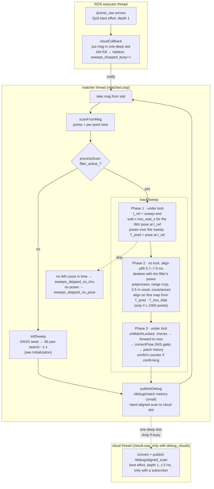

# Point cloud path

One LiDAR sweep from arrival to the pose update. Two threads: the ROS executor thread only hands the
message over; the matcher thread does all the work, one sweep at a time.

### ROS executor thread

`cloudCallback` puts the message into a one-deep slot and wakes the matcher thread. If the matcher is
still busy, the new sweep replaces the waiting one (counted in `sweeps_dropped_busy`): the newest sweep
always wins and no queue can build up behind a slow match.

### Matcher thread

1. Take the message from the slot and convert it to a `Scan` (points plus per-point time).
2. `processScan`: no filter → `initSweep` (the initializer, about 1 s); filter active → `trackSweep`.
3. `trackSweep` holds the lock only in the short phases:
   - **Phase 1 (lock).** `t_ref` = sweep end. Wait up to `imu_wait_s` for the IMU sample at `t_ref`
     (the sweep is published the instant its last slice is measured). Then the filter poses covering the
     sweep (for deskew) and `T_pred` = the pose at `t_ref` (the align warm start). Missing IMU or poses:
     the sweep is skipped and counted.
   - **Phase 2 (no lock; VGICP align p95 5.7–7.9 ms per sweep in the final runs).** Deskew with the filter's poses, preprocess (range crop, 0.5 m
     voxel, per-point covariances), align on the fine map from `T_pred · T_imu_lidar`, only with
     ≥ 1000 points. The IMU thread keeps predicting at 100 Hz meanwhile.
   - **Phase 3 (lock).** `onMatchLocked`: acceptance checks → forward the match to "now" with the
     filter's own motion → `correctPose` with the NIS gate → patch the stored history → health record;
     during confirmation, the confirm counter.
4. `publishDebug`: the small `/debug/match` array is published here; the aligned scan is only handed to the
   cloud thread. Then back to step 1.

### Debug outputs

A reliable publisher can wait for a slow viewer, and the next sweep would then wait too. So the matcher thread
publishes only the small message:

- `/debug/match` (10 numbers per sweep, `debug_metrics: true`) is published on the matcher thread; it is cheap.
- `aligned_scan` (about 10 600 points) is converted and published by its own thread, fed through a one-deep slot
  (dropped if busy), best effort, depth 1, at most `debug_cloud_rate_hz` (5 Hz), only with `debug_clouds: true`
  (default false) and only while someone subscribes.

The matcher loop is therefore only take → deskew → align → update, and no subscriber can slow it down. A
remaining live delay with a viewer attached is upstream of the node
([README, Known limitations](../README.md#known-limitations)).
