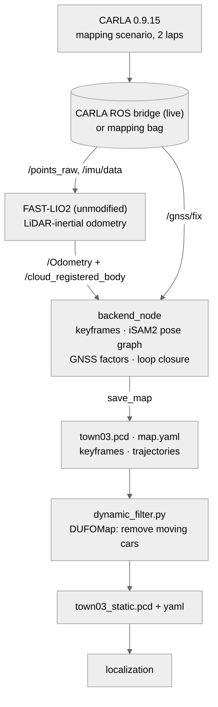
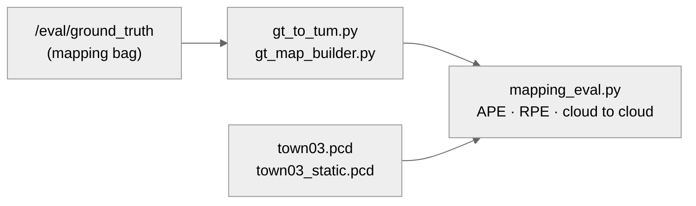
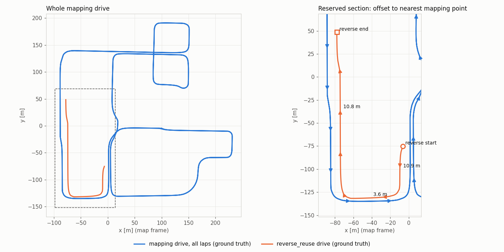
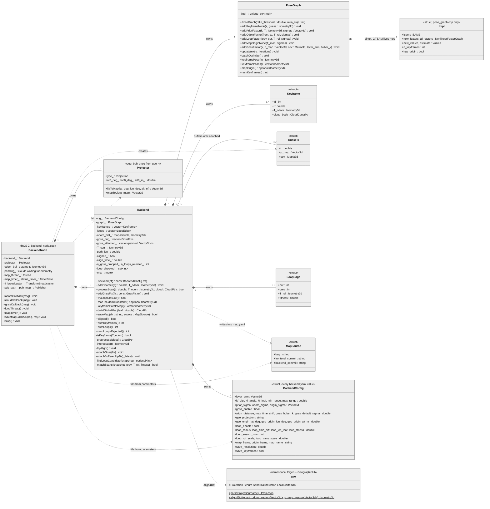
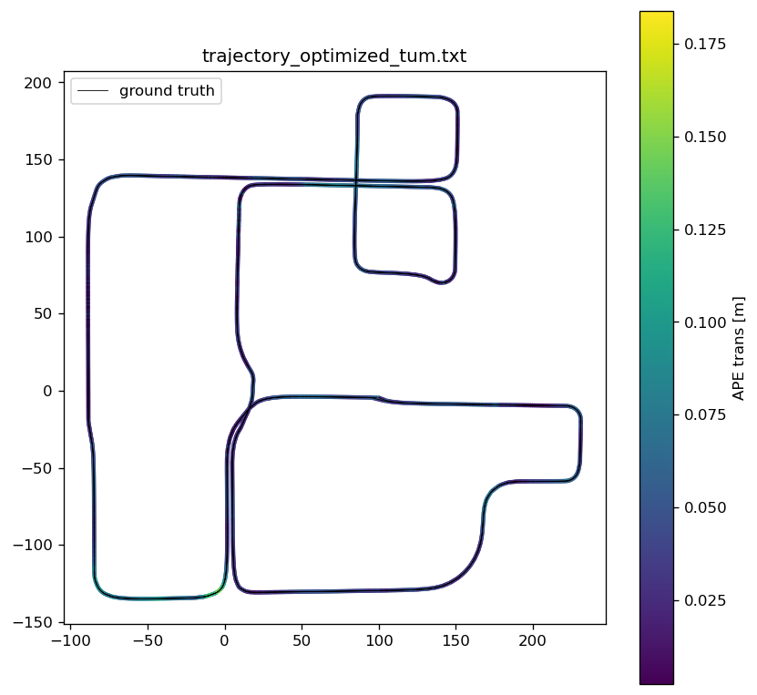
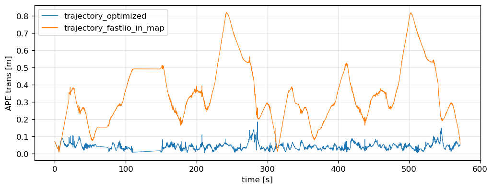
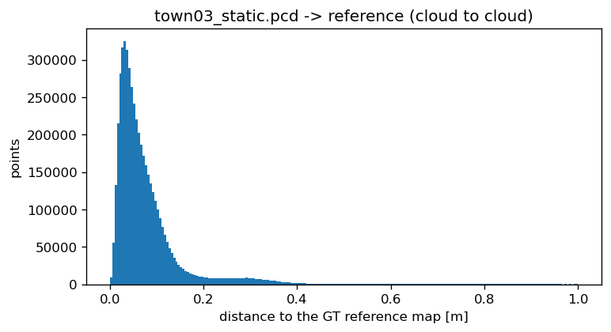
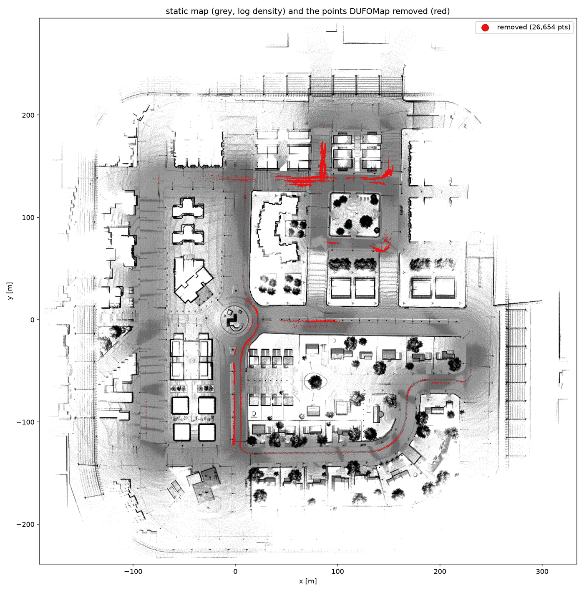

# brightdrive_mapping

Mapping backend for BrightDrive: keyframes from a LiDAR-inertial front-end, a GTSAM pose graph with odometry,
GNSS and loop-closure factors, and the georeferenced map. FAST-LIO (OmerMersin/FAST_LIO_OUSTER @ 8ffac51) is the
front-end; it is cloned unmodified in the Docker image and is not part of this package. Everything here is mine.

## Requirements

| Task requirement                                                               | Section                                                   |
| ------------------------------------------------------------------------------ | --------------------------------------------------------- |
| Mapping drive with overlapping passes and a reserved reverse-direction section | [Mapping drive](#mapping-drive)                           |
| Map built from my own pose estimate, no ground truth                           | [Purpose and input contract](#purpose-and-input-contract) |
| Open-source components and what I wrote                                        | [Pipeline](#pipeline)                                     |
| Map aligned to the CARLA / OpenDRIVE frame, transform chain                    | [Frames and extrinsics](#frames-and-extrinsics)           |
| LiDAR-to-base_link transform                                                   | [Frames and extrinsics](#frames-and-extrinsics)           |
| Map quality: relative and absolute metric                                      | [Results](#results)                                       |
| Dynamic vehicles                                                               | [Dynamic objects](#dynamic-objects)                       |

## Pipeline



Evaluation runs separately and is the only place ground truth is used:



The results below come from one recording: `mapping_20261105_070252` (the raw CARLA mapping drive) and
`fastlio_run_20261105_133549` (FAST-LIO's outputs on it), replayed so that every backend run sees identical input.
The nodes only subscribe to topics, so the input can also be the CARLA ROS bridge live ("How to run" has both).
These mapping bags (~4.7 GB) are not in the download; the maps built from them are. Ground truth reaches `eval/` only.

## Mapping drive

The map comes from scenario `mapping` of `sim/config/sim.yaml` (`{laps: 2, traffic: 10}`), recorded as
`mapping_20261105_070252`. Measured values are from its ground truth.

- **Route:** (100, -4) → (150, 70) → (90, 137) → (-50, 137) → (-90, 60) → (-50, -131) → (-2, -80) and back to the
  start, in map-frame metres. `sim/scenarios/make_route.py` fills in the roads between: 325 waypoints, 1 984 m per
  lap, many 90° turns and a roundabout.
- **Laps:** 2, so 2 × 1 984 m planned; 3 914 m driven in 569 s (the car cuts the corners).
- **Speed:** 8 m/s target, turns included; median 7.9 m/s, max 8.3 m/s, 52 s standing still in total along the way.
- **Traffic:** 10 Traffic Manager cars started near the route; red lights ignored, clear weather, GNSS noise 0.3 m.

**Overlaps.** Every position of the first lap is compared with the whole drive. 98.5 % of the loop is driven twice
in the same lane, once per lap; the other 1.5 % is one 12 m piece where two parts of the loop share a lane, driven
three or four times. Two streets get extra passes on another lane: the east street (x ≈ 1 to 16, y -120 to -11,
112 m) four times northbound in its two lanes, and the top street (y ≈ 131 to 138, x 14 to 141, 125 m) twice in
each direction. No stretch of the loop is driven the other way in the same lane.

**Reserved section.** The mapping drive covered this section in one direction only; the `reverse_reuse` scenario
drives it the opposite way, using the map without updating it.



## Purpose and input contract

The backend subscribes to three topics and needs nothing else:

| Topic | Type | Content |
|---|---|---|
| `/Odometry` | `nav_msgs/Odometry` | body (IMU) pose in the front-end's fixed frame (`origin_frame`), one per scan |
| `/cloud_registered_body` | `sensor_msgs/PointCloud2` | the deskewed scan in the body frame, same stamp as the pose |
| `/gnss/fix` | `sensor_msgs/NavSatFix` | raw fixes, with or without covariance |

A scan and a pose pair by stamp (1 ms). Any front-end that publishes these works unchanged: the frame name comes
from `backend.yaml`, and no class, function or member refers to FAST-LIO. Outputs: TF `map → origin_frame` on
every odometry message once GNSS alignment exists, `/mapping/path` after every keyframe and `/mapping/global_map`
every 5 s (both only while subscribed), the `/mapping/save_map` service, and the files in `/maps`.

`mapping_core` (`types.hpp`, `params.hpp`, `geo`, `PoseGraph`, `Backend`) is a static library without ROS
(Eigen, GTSAM, PCL, GeographicLib);
`backend_node.cpp` is the only ROS code. Frames: `map` → `origin_frame` (this backend: georeference and loop
correction) → the front-end's own frames. GNSS and loop closure are each a YAML switch.

## Frames and extrinsics

Every frame is REP-103: x forward (or east), y left (or north), z up. CARLA's own y points right; the sim bridge
flips y (and pitch, yaw) once, so every topic and file here is already in ROS axes.

| Frame | Meaning | Defined by |
|---|---|---|
| `map` | the map's frame: CARLA's world with y flipped, which is exactly what SphericalMercator gives for Town03's `<geoReference>` (lat0 = lon0 = 0); x east, y north | `map.yaml` `map.frame` and `map.projection` |
| `fastlio_origin` | the front-end's fixed frame: the IMU pose when FAST-LIO started, not gravity aligned | `origin_frame`; the backend publishes TF `map → fastlio_origin` (`T_map_origin`) once GNSS is aligned |
| `fastlio_odom`, `fastlio_imu` | FAST-LIO's own: a static identity below `fastlio_origin`, and the IMU body it estimates | `fastlio_carla.yaml` `frames` |
| `base_link` | the car: centre of the car on the ground | `sim/config/sensors.yaml` |
| `lidar`, `imu`, `gnss` | the sensors, children of `base_link` | `/tf_static` from `sensors.yaml` |

Extrinsics, `base_link` → sensor from `sim/config/sensors.yaml`. They are exact in simulation, so nothing estimates
them:

| Sensor | xyz [m] | rpy [deg] | Where mapping uses it |
|---|---|---|---|
| LiDAR | (0, 0, 1.9) | (0, 0, 0) | FAST-LIO `extrinsic_T` / `extrinsic_R`, LiDAR in the IMU frame; `extrinsic_est_en: false` |
| IMU | (0, 0, 0) | (0, 0, 0) | IMU = base_link, so FAST-LIO's body pose and every keyframe pose is a base_link pose |
| GNSS antenna | (0, 0, 1.8) | (0, 0, 0) | `backend.yaml` `gnss_lever_arm` |

Both nodes read these from their YAML files, not from `/tf_static`: a changed mount means editing `sensors.yaml`,
`fastlio_carla.yaml` and `backend.yaml` together. The backend logs the values it loaded at startup.

The transform chain of a map point and of a GNSS fix, with `X_k` the optimized keyframe pose in `fastlio_origin`:

    p_map         = T_map_origin · X_k · p_body,      p_body = T_imu_lidar · p_lidar (FAST-LIO: /cloud_registered_body)
    llaToMap(fix) = T_map_origin · X_k · lever_arm    (the GNSS factor)

`T_map_origin` is the georeference the GNSS factors estimate: xyz (100.052, -4.467, 0.009) m, yaw -0.91° for the
map in `/maps`. The ground truth (`/eval/ground_truth`, base_link in `map`) lives in the same frame, so APE needs no
alignment.

## Class diagram



`PoseGraph` is the only place GTSAM appears: Eigen types in, Eigen types out, keys `X(k)` for keyframes and `G(0)`
for `T_mo`. Prior and odometry are `PriorFactor`/`BetweenFactor<Pose3>` with diagonal sigmas, the loop factor a
`BetweenFactor<Pose3>` under Cauchy(1.0), the GNSS factor an `ExpressionFactor<Point3>` on
`T_mo · X_k · lever_arm` under Huber; no custom factor class. ICP, the candidate search, the voxel filter and the
file writers are file-local functions in `backend.cpp`. `geo` depends on Eigen and GeographicLib alone, so a
localizer can copy `geo.hpp`/`geo.cpp` and rebuild the map's `Projector` from `map.yaml`.

## How it works

**Keyframe.** A paired scan becomes a keyframe after 1 m or 0.2 rad since the last one. Its cloud is range-cropped
(3 to 100 m), voxelled (0.2 m) and kept in the body frame together with the raw pose. The graph gets one node
`X(k)` and one odometry factor `X(k-1) → X(k)` with the front-end's relative pose (sigma 1 cm, 0.06°); `X(0)`
carries a tight prior, so the graph frame is the odometry frame. One iSAM2 update per keyframe, then
`T_corr = X_k · T_odom,k⁻¹` records how far the optimized pose has moved from the raw one. Optimized poses live
only in the graph and are read back when needed, so nothing goes stale after a loop closure.

**GNSS.** The node projects every fix to map metres with one `geo::Projector`, built at startup from the
`geo_*` keys (`SphericalMercator` at lat0 = lon0 = 0 for CARLA, the formula `eval/` uses; "map.yaml contract"
below), and the backend buffers it. After 30 m of keyframe path, `geo::align4Dof` fits x, y, z and yaw between the
antenna positions along the odometry (`interpolate(t_fix) · lever_arm`) and the fixes; the result becomes the
node `G(0)` = `T_mo` (`map ← origin_frame`) with a weak prior (2° roll and pitch, loose yaw and xyz), estimated
with the rest of the graph from then on. Each fix becomes a factor `T_mo · X_k · lever_arm = z_k` on the keyframe
nearest in time, within 0.2 s, else it is dropped; the fix is moved to the keyframe's time with
`z_k = z_g + R_mo (p_ant(t_k) − p_ant(t_g))` from the interpolated odometry (under 1 cm at 15 m/s per degree of
`R_mo` error). Attach rule: at keyframe k every buffered fix not newer than t_k attaches to k or k−1, whichever
is nearer; newer fixes wait for the next keyframe, which may be nearer still. GNSS factors enter iSAM2 with the
next keyframe's update. A message without covariance gets diag(0.3 m)²; every GNSS factor is under Huber
(k = 1.345).

**Loop.** A thread at 1 Hz copies the poses and cloud pointers under the lock and works on the copy. Candidate:
the nearest keyframe within 10 m that is at least 30 s older; one ICP attempt per keyframe. Source: the current
scan at its estimate; target: the candidate ± 15 keyframes at theirs, voxel 0.4 m. Accepted if ICP converges
with fitness (mean squared point distance) below 0.3 m², otherwise counted as rejected. The factor
`X_prev → X_cur` gets sigma = √(fitness × scale), i.e. variance = fitness × scale with scales 0.0025 (rot) and
0.25 (trans): fitness 0.04 m² gives 0.57° and 0.10 m. Cauchy(1.0) on top, then five extra iSAM2 iterations.

**Save.** From the `save_map` service or at shutdown (`main()` after `spin()`, never a destructor): a
Levenberg-Marquardt batch solve over all factors from the current estimate, then the five files below, with the
keyframe clouds placed at `T_mo · X_k` and voxelled at 0.2 m. Before alignment the files are written in
`origin_frame` and `map.yaml` says `georeferenced: false`. The lock is held for the whole write.

**One lock.** `Backend` owns all state and one mutex. The node runs the three subscriptions in one mutually
exclusive callback group; the loop thread and the map timer lock only to copy and, for a loop, to add the factor.

## Parameters (`config/backend.yaml`)

Every noise value is a sigma in GTSAM Pose3 order: rot x, y, z [rad] then trans x, y, z [m]. Backend values
have no defaults: a missing or non-positive value stops the node at startup with the key's name. The `geo_*`
keys are the exception to "positive": required and finite, latitude in [-90, 90], longitude in [-180, 180], and
an unknown projection name stops the node too. The node logs every value it loaded.

| Name | Unit | Value | Meaning |
|---|---|---|---|
| `odom_topic` | | `/Odometry` | front-end pose, body in `origin_frame` |
| `cloud_topic` | | `/cloud_registered_body` | deskewed scan in the body frame, same stamp |
| `gnss_topic` | | `/gnss/fix` | raw NavSatFix, never gated |
| `path_topic` | | `/mapping/path` | keyframes in `map_frame`, after every keyframe |
| `map_topic` | | `/mapping/global_map` | the map in `map_frame`, built only while subscribed |
| `save_service` | | `/mapping/save_map` | `std_srvs/Trigger`; the same writer runs at shutdown |
| `publish_tf` | | true | `map_frame → origin_frame` on every odometry message, once aligned |
| `loop_frequency` | Hz | 1.0 | how often the loop thread tries the latest keyframe |
| `map_period` | s | 5.0 | between two `/mapping/global_map` builds |
| `save_dir` | | `/maps` | where the files go (`MAPS_DIR` in compose) |
| `source_bag`, `frontend_commit`, `backend_commit` | | set by the launch | provenance written into `map.yaml`; empty when not given |
| `gnss_lever_arm` | m | [0, 0, 1.8] | antenna in the IMU frame (`sim/config/sensors.yaml`) |
| `kf_dist` | m | 1.0 | translation since the last keyframe that makes a new one |
| `kf_angle` | rad | 0.2 | rotation since the last keyframe that makes a new one |
| `kf_leaf` | m | 0.2 | voxel size of the cloud stored per keyframe |
| `min_range` | m | 3.0 | drops the car's own returns |
| `max_range` | m | 100.0 | sensor range |
| `prior_sigma` | rad, m | 1e-3 ×6 | prior on `X(0)`, pins the graph frame onto the odometry frame |
| `odom_sigma` | rad, m | [1e-3 ×3, 0.01 ×3] | odometry factor, 0.06° and 1 cm |
| `origin_sigma` | rad, m | [0.035, 0.035, 1.0, 10, 10, 10] | prior on `T_mo`: 2° roll and pitch, loose yaw and position |
| `gnss_enable` | | true | GNSS factors and alignment; false means `T_mo = I` from the start |
| `align_distance` | m | 30.0 | keyframe path before the 4-DoF fit of `T_mo` |
| `max_time_shift` | s | 0.2 | a fix farther than this from every keyframe is dropped |
| `gnss_huber_k` | sigma | 1.345 | Huber threshold on GNSS residuals |
| `gnss_default_sigma` | m | 0.3 | used when a NavSatFix carries no covariance |
| `geo_projection` | | `SphericalMercator` | `SphericalMercator` (CARLA bags) or `LocalCartesian` (WGS-84: receivers, Gazebo, Isaac, AWSIM); written into `map.yaml` (`map.projection.type`) |
| `geo_origin_lat_deg`, `geo_origin_lon_deg` | deg | 0.0, 0.0 | projection origin, Town03's OpenDRIVE `<geoReference>` (`+lat_0=0 +lon_0=0`) |
| `geo_origin_alt_m` | m | 0.0 | altitude that maps to z = 0 |
| `loop_enable` | | true | loop-closure thread |
| `loop_radius` | m | 10.0 | candidate must be this close |
| `loop_time_diff` | s | 30.0 | candidate must be this much older |
| `loop_search_num` | | 15 | keyframes on each side of the candidate in the ICP target |
| `loop_icp_leaf` | m | 0.4 | voxel size of source and target for ICP |
| `loop_fitness` | m² | 0.3 | accept below this ICP mean squared distance |
| `loop_rot_scale` | rad²/m² | 0.0025 | loop sigma (rot) = √(fitness × scale) |
| `loop_trans_scale` | m²/m² | 0.25 | loop sigma (trans) = √(fitness × scale) |
| `map_frame` | | `map` | georeferenced frame of the map |
| `origin_frame` | | `fastlio_origin` | the front-end's fixed frame (`fastlio_carla.yaml` `frames.map_frame`) |
| `map_name` | | `town03` | `<save_dir>/<map_name>.pcd` |
| `save_resolution` | m | 0.2 | voxel size of the saved and published map |
| `save_keyframes` | | false | also write `<save_dir>/keyframes/NNNNNN.pcd` per keyframe for the dynamic-object filter; a launch argument too |

## Outputs in `/maps`

| File | Content |
|---|---|
| `town03.pcd` | the map: keyframe clouds at optimized poses in `map`, voxel 0.2 m, binary XYZI |
| `trajectory_optimized_tum.txt` | keyframes in `map`, `t x y z qx qy qz qw`; the evo input |
| `trajectory_fastlio_tum.txt` | the same keyframes at their raw front-end poses in `origin_frame` |
| `loops.txt` | accepted loop closures, `cur prev fitness` |
| `map.yaml` | the `map` block a localizer reads (pcd, frame, projection, resolution), then provenance and quality: `source`, `mapping` (`T_map_origin`, counts, loops), `gnss` (lever arm, factors, dropped, residual RMS, alignment time); "map.yaml contract" below |
| `keyframes/NNNNNN.pcd` | with `save_keyframes`: every keyframe cloud in `map`, its pose in the PCD `VIEWPOINT` line (DUFOMap unified format) |
| `town03_static.pcd`, `town03_static.yaml`, `town03_dynamic.pcd`, `town03_dynamic_bev.png` | written by `scripts/dynamic_filter.py`: the map without dynamic objects, its `map.yaml` (same contract, `pcd` points at the static file, plus a `dynamic_filter` block), what it removed, and the picture |

## map.yaml contract

`map.yaml` has two parts. The `map` block is what a localizer reads: the file to load, its frame, how a GNSS
fix becomes map metres, and the voxel size. Everything after it (`source`, `mapping`, `gnss`) is provenance and
quality, useful for a report and never needed to use the map. Run c:

```yaml
map:
  pcd: town03.pcd                  # file in the same folder as this yaml
  frame: map
  georeferenced: true              # false -> projection.type: Local, no origin keys
  projection:                      # from backend.yaml geo_*
    type: SphericalMercator
    origin_lat_deg: 0.0
    origin_lon_deg: 0.0
    origin_alt_m: 0.0
  resolution_m: 0.2
```

`SphericalMercator` is how CARLA generates lat/lon (the inverse of its `GeoLocation::Transform`). With
R = 6 378 137 m, k = cos(lat0) and angles in radians:

    x = k R (lon − lon0),   y = k R (ln tan(π/4 + lat/2) − ln tan(π/4 + lat0/2)),   z = alt − alt0

Town03's OpenDRIVE `<geoReference>` is `+lat_0=0 +lon_0=0`, so k = 1 and the shifts vanish: x = R lon,
y = R ln tan(π/4 + lat/2), z = alt. A map saved before GNSS alignment has `georeferenced: false`,
`frame: <origin_frame>` and `projection: {type: Local}`.

Two projections exist. `SphericalMercator` is for CARLA bags only: CARLA generates its lat/lon with that
formula, so nothing else reproduces its metres. `LocalCartesian` is for everything that gives real WGS-84
coordinates (a receiver, Gazebo, Isaac Sim, AWSIM): `GeographicLib::LocalCartesian` at the origin, x east,
y north, z up (REP-103), exact on the ellipsoid, so the origin should sit inside the mapped area. Both are set
in `backend.yaml` and copied into the `projection` block, and that block is what makes a map usable by the
localizer: it rebuilds the same `Projector` from `map.yaml` and projects its own fixes into the map's metres.
Same idea as Autoware's `map_projector_info.yaml`; real data = LocalCartesian (GeographicLib) at an origin inside
the area, set in `backend.yaml`; localizer code unchanged. `tools/geo_check.cpp` checks both without GTest
(`ros2 run brightdrive_mapping geo_check`): LocalCartesian at 30 N 31 E maps its origin to zero, +0.001° of
latitude to +110.85 m north and +0.001° of longitude to +96.49 m east, and inverts within 1e-9°; SphericalMercator
reproduces the fixed formula on three fixes of the run c bag.

The rest of the file: `source` (bag, front-end and backend commits at launch time), `mapping` (`origin_frame`,
`T_map_origin` as xyz, quaternion and roll/pitch/yaw in degrees, keyframes, path length, map points, loops
accepted and rejected) and `gnss` (lever arm, factors, dropped, per-axis residual RMS of the final solve,
alignment time). `T_map_origin` keeps full precision; the other numbers are rounded for reading.

## Maps

The maps are not in git (`*.pcd` is ignored). Download them from
[Google Drive](https://drive.google.com/drive/folders/1Glp70xwr7zoCV1obQUhzevf8z3eG_zW0?usp=sharing) (folder
`maps/`, checksums in `UPLOAD_LIST.md`) and put the four files in `MAPS_DIR` (`/var/tmp/brightdrive_maps` on the
host, `/maps` in the containers). The commands here and the localizer then work as written.

## How the map is made

```
docker compose up -d mapping && docker compose exec mapping bash       # host: the container has FAST-LIO, GTSAM, DUFOMap
colcon build && source install/setup.bash                              # container: this package
ros2 launch brightdrive_mapping backend_replay.launch.py bag:=/bags/fastlio_run_20261105_133549 save_dir:=/maps/run4 save_keyframes:=true run_dynamic_filter:=true
```

One launch does the rest: backend + bag replay, `save_map` when the bag ends, DUFOMap over the saved keyframes.
`/maps/run4` then holds `town03.pcd` + `map.yaml` (the contract) and `town03_static.pcd` + `town03_static.yaml`,
with the trajectories and `loops.txt`. A raw CARLA bag needs FAST-LIO live first ("Full pipeline" below).

## How to run

Inside the `mapping` container (`docker compose up -d mapping && docker compose exec mapping bash`, repo mounted
at `/ws/src/brightdrive_localization`, bags at `/bags`, maps at `/maps`):

```
colcon build                              # mapping/ only (docker/colcon_defaults.yaml); then source install/setup.bash
ros2 run brightdrive_mapping geo_check    # the projector checks (LocalCartesian, SphericalMercator); exit 0 = pass
```

Replay of a recorded FAST-LIO run (the results below):

```
ros2 launch brightdrive_mapping backend_replay.launch.py [bag:=/bags/fastlio_run_20261105_133549] [rate:=2] [save_dir:=/maps]
                                     [save_keyframes:=true] [loop_enable:=false] [run_dynamic_filter:=true]
```

The launch starts the node and plays the bag 3 s later at `rate` (the run bags were recorded at half speed and
have no `/clock`, so rate 2 is real time). When the bag ends it waits 5 s for the queued scans, calls
`/mapping/save_map` through `scripts/save_map.py` (exit 0 only when the backend reports success), with
`run_dynamic_filter:=true` runs `scripts/dynamic_filter.py` on `save_dir`, and shuts down; the node skips its own
shutdown save when nothing arrived after the service save. The launch also passes the bag path and the two git
commits for `map.yaml`; `save_keyframes` and `loop_enable` override the YAML for one run (the per-keyframe PCDs
for the dynamic-object filter, and the no-loop row of the table below). `ros2 run brightdrive_mapping save_map.py`
saves mid-run without stopping.

Full pipeline, FAST-LIO live on a raw CARLA bag (`/points_raw`, `/imu/data`, `/gnss/fix`, `/clock`), three
terminals:

```
ros2 bag play /bags/mapping_20261105_070252 --rate 0.5 --start-offset 2   # offset skips the spawn drop, so the IMU init sees a still car
ros2 launch fast_lio mapping.launch.py rviz:=false use_sim_time:=true \
    config_path:=/ws/src/brightdrive_localization/mapping/brightdrive_mapping/config config_file:=fastlio_carla.yaml
ros2 run brightdrive_mapping backend_node --ros-args \
    --params-file /ws/src/brightdrive_localization/mapping/brightdrive_mapping/config/backend.yaml \
    -p save_dir:=/maps -p source_bag:=/bags/mapping_20261105_070252
```

Ctrl-C on the backend saves the map. The backend never reads the clock, only header stamps, so `use_sim_time`
does not matter to it. Whether FAST-LIO keeps up at rate 1 on this machine was not measured; the recorded run
used 0.5 and lost no scan. Run this way on the same bag: 11 441 scans paired, 3 329 keyframes, 547 loops accepted
(twice the replay's: at half speed the 1 Hz loop thread sees every keyframe), APE 0.044 m RMSE without alignment.
`ros2 run` knows no commits; pass `-p frontend_commit:=... -p backend_commit:=...` if `map.yaml` should carry them.

Evaluation (host, evo): `evo_ape tum ground_truth_imu_tum.txt trajectory_optimized_tum.txt -r trans_part --t_max_diff 0.005`
without `--align`: the map is georeferenced, an alignment would hide a `T_mo` error. Trajectories are the IMU
frame; GT is converted with `T_base_imu` before evaluation (`eval/gt_to_tum.py`, run inside the container).

## Results

Map quality at a glance, for `town03_static.pcd` (the map localization uses) and the trajectory it was built from.
How each number is computed: `eval/results/README.md`.

| Metric | What it says | Value |
|---|---|---|
| APE RMSE / max, no alignment | global accuracy: keyframe positions against ground truth in the georeferenced frame | 0.047 / 0.184 m |
| RPE over 1 m, RMSE | local consistency: error of the motion between poses 1 m apart | 0.014 m |
| RPE over 100 m, RMSE | drift over 100 m of travel | 0.126 m |
| map → reference, mean / p95 | accuracy: distance from each map point to the ground-truth reference map (0.2 m voxels bottom out near 0.1 m) | 0.084 / 0.252 m |
| map points beyond 0.5 m | ghost or misplaced structure | 1.04 % |
| reference → map, mean / p95 | completeness: distance from each reference point to the map | 0.124 / 0.368 m |
| reference points beyond 0.5 m | structure the map is missing | 2.31 % |
| GNSS residual RMS x / y / z | agreement with GNSS; at the 0.3 m noise, so no bias | 0.303 / 0.301 / 0.299 m |
| loop closures accepted / rejected | how often the overlapping passes were matched | 273 / 5 |
| removed as dynamic, raw points / cells | what DUFOMap took out ("Dynamic objects") | 0.82 % / 0.29 % |

`/bags/fastlio_run_20261105_133549`: two laps of Town03, 572 s, 3 918 m of path, 11 442 scans at 20 Hz, 5 724 GNSS
fixes at 10 Hz with 0.3 m noise, replayed with the launch above.

| | Value |
|---|---|
| scans / paired / unsynced | 11 442 / 11 442 / 0 |
| keyframes | 3 329 |
| GNSS alignment | after 27 keyframes; final `T_mo` xyz (100.052, -4.467, 0.009) m, yaw -0.91° |
| GNSS factors / dropped / residual RMS | 5 118 / 604 (no keyframe within 0.2 s, slow stretches) / (0.303, 0.301, 0.299) m |
| loops accepted / rejected | 273 / 5 (ICP fitness median 0.04 m²) |
| map | 4 968 367 points, 79.5 MB, saved in 2.3 s |

APE of `trajectory_optimized_tum.txt` against the CARLA ground truth, 3 329 of 3 329 keyframes matched at 1 ms,
without `--align`:

| APE | RMSE [m] | mean [m] | max [m] |
|---|---|---|---|
| 3-D translation | 0.047 | 0.042 | 0.184 |
| horizontal | 0.037 | 0.031 | 0.184 |
| z | 0.029 | 0.024 | 0.098 |

Rotation RMSE 0.125° (yaw 0.056°); the per-axis mean error is under 1 cm, so `T_mo` carries no bias.





What each stage contributes, same bag, all against the IMU-frame ground truth (`eval/gt_to_tum.py`), 3 329
keyframes matched at 1 ms; APE without `--align` except the labelled row; RPE translation RMSE at `--delta 1
--delta_unit m`:

| Trajectory | APE 3-D RMSE / mean / max [m] | horizontal RMSE / mean / max [m] | z RMSE / mean / max [m] | RPE 1 m, translation RMSE [m] |
|---|---|---|---|---|
| (a) FAST-LIO only, placed in `map` with the backend's `T_mo`, no align | 0.391 / 0.349 / 0.819 | 0.169 / 0.150 / 0.391 | 0.353 / 0.297 / 0.794 | 0.014 |
| (a) FAST-LIO only, raw, SE(3)-aligned | 0.126 / 0.105 / 0.333 | 0.122 / 0.099 / 0.333 | 0.033 / 0.023 / 0.103 | 0.014 |
| (b) backend, `loop_enable: false`, no align | 0.059 / 0.054 / 0.196 | 0.044 / 0.039 / 0.196 | 0.039 / 0.031 / 0.129 | 0.014 |
| (c) full backend, no align | 0.047 / 0.042 / 0.184 | 0.037 / 0.031 / 0.184 | 0.029 / 0.024 / 0.098 | 0.014 |

The raw front-end drifts to 0.33 m over the two laps and, placed in the map with one rigid `T_mo`, is off by
0.8 m at worst, mostly in z: its frame tilts and sinks with time, which one transform cannot follow. GNSS alone
(b) pins it to 0.059 m; the loop closures (c) take a further 20 % off, most of it in z. RPE at 1 m is the same
0.014 m for all four, as it must be: the backend moves keyframes, not the odometry between neighbours.

## Dynamic objects

Other road users leave streaks in a map built from a moving sensor: a car seen in three keyframes is in the map
three times. DUFOMap ("DUFOMap: Efficient Dynamic Awareness Mapping", Duberg, Zhang, Jia, Jensfelt, RA-L 2024)
removes them per scan: the rays of every keyframe are cast from its viewpoint into a voxel grid, and a voxel that
rays passed through at one time but holds points at another was empty once, so those points are dynamic. Static
structure is hit from many viewpoints and never seen through. The backend writes the per-keyframe input with
`save_keyframes` (every cloud in `map`, its pose in the PCD `VIEWPOINT` line: the DynamicMap_Benchmark unified
format); `scripts/dynamic_filter.py` runs DUFOMap with the published settings of its own `main.py` (resolution
0.1 m, d_s 0.2 m, d_p 2), untuned, and writes `town03_static.pcd`, the removed points as `town03_dynamic.pcd`, and
a top-down picture.

```
ros2 launch brightdrive_mapping backend_replay.launch.py save_keyframes:=true run_dynamic_filter:=true   # both steps
ros2 run brightdrive_mapping dynamic_filter.py /maps                                                    # the filter alone
```

The filter takes the mapping output folder and nothing else: `map.yaml` there gives the map's name, frame and
voxel size, `keyframes/` is the input, and it stops with "re-run mapping with `save_keyframes:=true`" when that
folder is missing. The container has `dufomap` (Dockerfile); on a host it is `pip install dufomap`.

On the run above (`sim.yaml` `mapping: {laps: 2, traffic: 10}`, ten Traffic-Manager cars near the route), 3 329
keyframes and 26.3 M points, 78 s to integrate and 10 s to label on 20 threads:

| | points | map → GT reference mean / p95 [m] | GT reference → map mean / p95 [m] |
|---|---|---|---|
| `town03.pcd`, every keyframe point | 4 968 367 | 0.084 / 0.251 | 0.123 / 0.364 |
| `town03_static.pcd` | 4 953 789 (0.29 % fewer) | 0.084 / 0.252 | 0.124 / 0.368 |
| removed, `town03_dynamic.pcd` | 26 654 cells, 215 216 raw points (0.82 %) | 0.063 / 0.145 | |



Two things the numbers say. First, cloud-to-cloud distance cannot measure the removal: the GT reference
(`eval/gt_map_builder.py`, the raw scans at ground-truth poses) contains the same ten cars at every sweep time, so
a removed car point has a reference neighbour as well; the unchanged 0.084 m says the filter did no harm, nothing
more. Second, the failure mode is road surface under and behind the moving cars: of the removed cells, 18 % are
the cars themselves (hit in three keyframes or fewer, 87 % of them 0.3 to 2.5 m above the road) and 82 % are
persistent ground within 0.3 m of the local surface, 8 to 14 m from the sensor and 72 % within 3 m of a car
cell, where the space a car freed, inflated by d_p, reaches the road. Nothing above 2.5 m (walls, poles, trees) was
removed and far ground is 2.5 % of it, so grazing-angle ground is not the issue here. `town03_dynamic_bev.png`
shows the removals as streaks along the lanes the ten cars drove.



## Known limitations / future work

- **The dynamic filter also removes road.** 82 % of what DUFOMap removed is road surface near the moving cars.
  Future: label ground on each keyframe (e.g. Patchwork++) and keep ground points whatever DUFOMap says.
- **Loop detection runs on a 1 Hz timer** (as in LIO-SAM), so which keyframes get checked depends on drive and
  replay speed (273 vs 547 loops on the same bag). Future: trigger the check by distance travelled (e.g. every 5 m).
- **GNSS does most of the global work here.** With 0.3 m GNSS the loops add about a fifth of the accuracy; the
  backend was not evaluated with poor or missing GNSS.
- **Everything is kept for the whole drive** (all keyframes and clouds, no marginalization): 0.8 GB at 2 400
  keyframes. Fine for this route; a much longer drive would need submaps or keyframe pruning.
