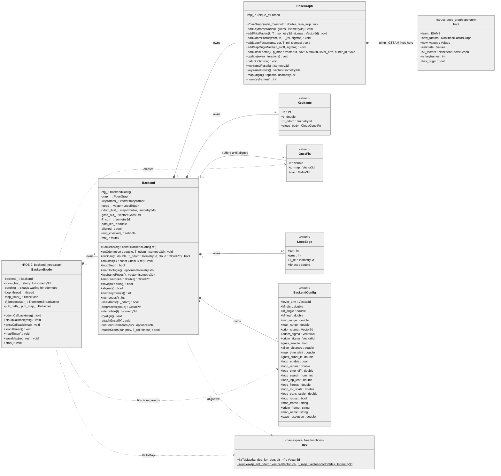

# brightdrive_mapping — design

My mapping package. FAST-LIO is upstream (OmerMersin/FAST_LIO_OUSTER @ 8ffac51), cloned unmodified in the
Docker mapping stage, not stored in this repo. The backend (pose graph, loop closure, GNSS factors) is my code.

Design decided 6 Nov 2026, implementation in progress. Online backend with iSAM2, ported from drone_slam's
`fast_lio_sam` (keyframes, BetweenFactor, iSAM2 update per keyframe, loop-closure thread, map timer, save
service), plus a georeferencing variable set by GNSS. Pure C++ core (`mapping_core`: two classes, four structs,
one namespace of free functions) plus a thin ROS 2 node. The system-level picture is in the repository README
under "Mapping pipeline".

## Class diagram

Files: `types.hpp` (Keyframe, GnssFix, LoopEdge, `CloudPtr` = `pcl::PointCloud<pcl::PointXYZI>::Ptr`),
`params.hpp` (BackendConfig), `geo.hpp`, `pose_graph.hpp/.cpp`, `backend.hpp/.cpp`, `backend_node.cpp`. ICP,
the loop candidate search and the four writers (pcd, TUM, map.yaml, loops.txt) are file-local functions in
`backend.cpp`. No `gnss_factor.hpp`.

Design notes behind the diagram:

- Graph frame = `fastlio_odom`. X(0) gets a tight prior at the first keyframe's `T_odom`; every later keyframe
  adds one node and one odometry factor with sigma 1 cm / 0.06°, then one iSAM2 `update()`.
- Optimized poses live only in the graph. `Keyframe` has no `opt` field; `Backend` reads `keyframePoses()` when it
  needs them, so nothing goes stale after a loop closure.
- `PoseGraph` API: `*Node` adds a value, `*Factor` adds an edge. Eigen types only (`Isometry3d`, `Vector3d`,
  `Matrix3d`, `Vector6d`); the header has no GTSAM include. drone_slam's plain `Pose` struct existed because of
  two Eigen builds; this image has one. Not thread-safe: `Backend` holds the mutex for every call (said in the
  header comment).
- Keys: `symbol_shorthand` `X(k)` for keyframes and `G(0)` for T_mo, never raw int keys. drone_slam's raw keys
  plus a loop over `estimate.size()` break once `G(0)` exists; `keyframePoses()` loops `k = 0..numKeyframes()-1`.
- Pimpl: `struct PoseGraph::Impl` is defined only in `pose_graph.cpp` and holds `ISAM2 isam` (ISAM2Params:
  relinearize threshold 0.1, skip 1), `new_factors`, `new_values`, `estimate`, `all_factors`, `n_keyframes`,
  `has_origin`. Every `add*Factor` also appends to `all_factors`. The destructor is defined in the `.cpp`
  (= default).
- Factors and noise: `addPriorFactor` and `addOdomFactor` are `PriorFactor<Pose3>` / `BetweenFactor<Pose3>` with
  Gaussian noise; `addLoopFactor` is a `BetweenFactor<Pose3>` with a Cauchy(1.0) robust kernel; `addGnssFactor`
  is an `ExpressionFactor<Point3>` on `T_mo * X_k * l - p_map`, `Gaussian::Covariance(cov)` wrapped in
  Huber(`huber_k`). No custom factor class.
- `update(extra)`: `isam.update(new_factors, new_values)` plus `extra` passes, clear both new buckets,
  `estimate = calculateEstimate()`.
- T_mo is `G(0)`, added once by `addMapOriginNode(T_mo0, origin_sigma)` together with its weak prior: sigma about
  2° on roll and pitch, loose yaw and xyz. FAST-LIO's frame is the IMU at start (R0 = I, not gravity-aligned), so
  roll and pitch of T_mo are the car's start attitude, which the 2° covers. `mapOrigin()` is empty before that
  call.
- Guards: `addGnssFactor` before `addMapOriginNode` throws; `addMapOriginNode` twice throws.
- Sigmas everywhere: every noise parameter is a sigma, not a variance, in GTSAM order rot x, y, z [rad] then
  trans x, y, z [m], built with `Diagonal::Sigmas`. `backend.yaml` keys are named `*_sigma`.
- `geo::alignYaw` is a 4-DoF fit (x, y, z, yaw) of antenna positions in odom (`T_odom · lever_arm`) against
  `p_map`. It gives T_mo0 once the keyframe path length reaches 30 m.
- `batchOptimize()` runs only in `save()`: Levenberg-Marquardt on `all_factors` with the current `estimate` as
  the initial guess; the result replaces `estimate`. After alignment the live path uses `update()` with extra
  iterations, no reseeding.
- `BackendConfig` holds only what `Backend` uses. Topic names, `publish_tf`, loop frequency and the map period
  stay in the node. The two frame names are in the config because `map.yaml` records them.
- One lock. The node runs the odometry and cloud callbacks in one mutually exclusive callback group; a
  loop-closure `std::thread` calls `loopStep()` at the loop frequency; a timer publishes the map. ICP and map
  assembly run on snapshots outside `mtx_`.
- TF `map → fastlio_origin` = T_mo · T_corr, published in `odomCallback` with that message's stamp. With GNSS
  enabled and not yet aligned `mapToOrigin()` is empty and nothing is published; the alignment moment is logged.
  With GNSS disabled T_mo = I and T_corr alone is published.
- `save()` runs from the service and from `main()` after `spin()` returns (via `stop()`), never from a destructor.
- Dropped from drone_slam: `marginalCovariance`, the odom-frame pcd, `transformations.pcd`, `summary.txt`.

## Responsibilities

- `Backend`: turns paired scans, odometry and fixes into keyframes, graph factors and the map; owns all state and
  the one mutex.
- `PoseGraph`: the only place GTSAM types appear; keyframe and map-origin nodes, prior, odometry, loop and GNSS
  factors, iSAM2 updates, the batch solve for `save`, poses out.
- `Keyframe`, `GnssFix`, `LoopEdge`: immutable data records; `GnssFix` is already in map metres with the
  message covariance.
- `BackendConfig`: every `backend.yaml` value with its unit, validated once in the `Backend` constructor.
- `geo`: lat/lon/alt to map metres with the Mercator formula validated in `eval/` (lat0 = lon0 = 0,
  R = 6 378 137 m, decisions.md §7) and the 4-DoF T_mo0 from antenna positions.
- `BackendNode`: ROS wiring only: parameters and their startup log, stamp pairing, message conversion, TF, path
  and map publishers, loop thread, map timer, save service, `stop()`.

## Call sequence

### One keyframe (`onScan`)

1. The node pairs a `/cloud_registered_body` with the `/Odometry` of the same stamp and calls
   `onScan(t, T_odom, cloud)`.
2. Lock. `isKeyframe`: distance to the last keyframe ≥ 1.0 m or angle ≥ 0.2 rad, else return false.
3. `preprocess`: range crop 3 to 100 m, voxel 0.2 m, body frame, PointXYZI.
4. Push `Keyframe{k, t, T_odom, cloud}`; `path_len_` grows by the step.
5. k = 0: `addKeyframeNode(0, T_odom)` and `addPriorFactor(0, T_odom, prior_sigma)` (tight).
   Else `T_rel = T_odom,k-1⁻¹ · T_odom,k`, `addKeyframeNode(k, X_k-1 · T_rel)`,
   `addOdomFactor(k-1, k, T_rel, odom_sigma)`.
6. `update()`; `T_corr_ = X_k · T_odom,k⁻¹`.
7. GNSS, if enabled. Aligned: `attachGnss` for buffered fixes whose nearest keyframe in time is k.
   Not aligned and `path_len_` ≥ 30 m: `tryAlign`: antenna positions `interpolate(t_fix) · lever_arm` for every
   buffered fix, `geo::alignYaw` against their `p_map` → T_mo0, `addMapOriginNode(T_mo0, origin_sigma)`,
   `attachGnss` for all buffered fixes, `update(extra_iterations)`, refresh `T_corr_`, set `aligned_`, log the
   moment.
8. Unlock, return true. The node logs the keyframe count.

`attachGnss` picks the keyframe nearest in time (≤ 50 ms, else the fix is dropped), shifts the fix to the
keyframe time with the odometry displacement between the two stamps rotated by the current R_mo, then calls
`addGnssFactor(k, p, cov, lever_arm, huber_k)`.

TF is not part of this sequence: `odomCallback` publishes `mapToOrigin()` on every `/Odometry`.

### One loop step (`loopStep`, from the loop thread)

1. Lock, snapshot: current id, all estimates, cloud pointers. Unlock.
2. `findLoopCandidate(cur)`: nearest keyframe within 10 m that is at least 30 s older and not in
   `loop_checked_`. None: return false.
3. Source = current cloud at X_cur. Target = keyframes prev ± 15 at their estimates, voxel 0.4 m.
4. ICP. Not converged or fitness ≥ 0.3: mark checked, return false.
5. `T_rel = X_prev⁻¹ · T_icp · X_cur`; `LoopEdge{cur, prev, T_rel, fitness}`.
6. Lock. `addLoopFactor(prev, cur, T_rel, sigma from fitness × scales)` (Cauchy robust inside), `update(5)`,
   refresh `T_corr_`, push the edge. Unlock, return true.

### Save (`save(dir)`, from the service and from `main()` after spin)

1. Lock. `batchOptimize()`: Levenberg-Marquardt on `all_factors` from the current estimate; re-read
   `keyframePoses()` and `mapOrigin()`.
2. Poses in the map frame: `T_mo · X_k`.
3. Write `<map_name>.pcd` (keyframe clouds at those poses, voxel 0.2 m), `trajectory_optimized_tum.txt`
   (`t x y z qx qy qz qw`), `map.yaml`, `loops.txt` (`cur prev fitness`). Unlock.

## Verification

No unit tests in this phase. The end-to-end check is evo APE of `trajectory_optimized_tum.txt` against
`/eval/ground_truth` without `--align`: the map is georeferenced, so any alignment would hide a T_mo error. The
node itself is checked by the launch exit check: node and service listed, TF present after alignment.
